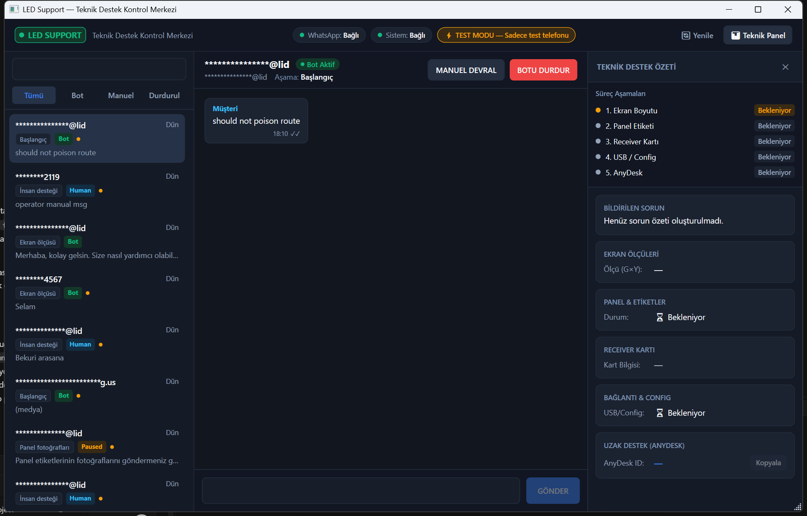
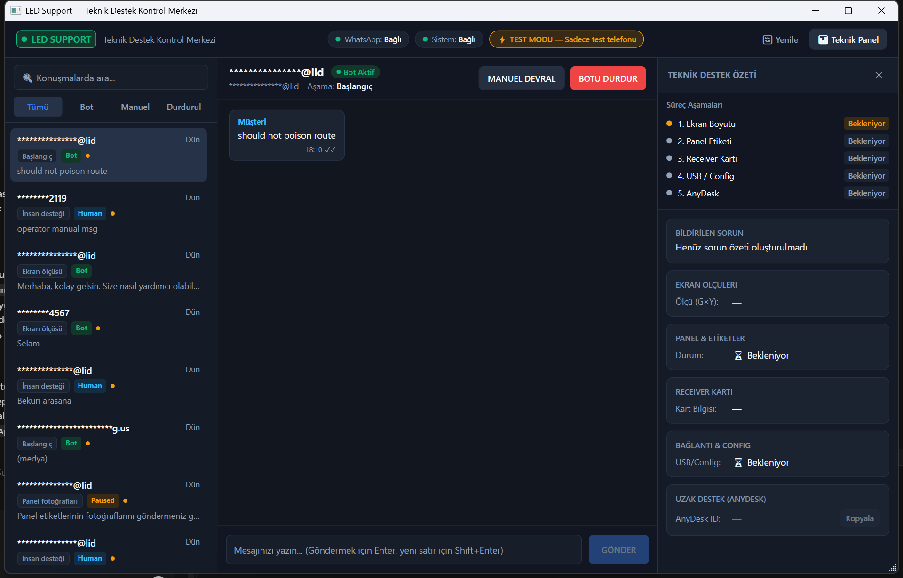
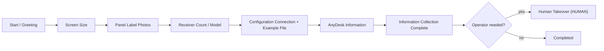
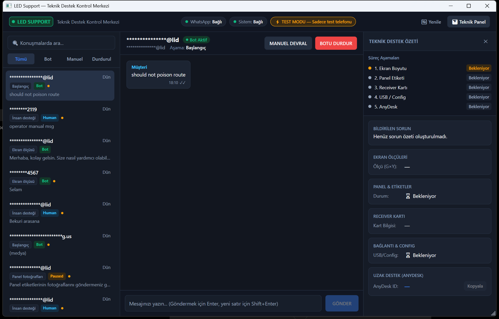
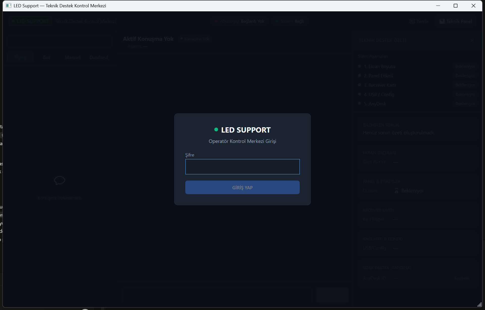

# LedSupBot

<p align="center">
  <a href="README.md">🇹🇷 Türkçe</a> &nbsp;|&nbsp; <strong>🇬🇧 English</strong>
</p>

> **WhatsApp-based LED display technical support.** LedSupBot receives customer messages through a Baileys-based linked-device connector, persists the conversation and support case in PostgreSQL via an ASP.NET Core backend, produces technical-knowledge-grounded answers with RAG + Gemini, and gives the operator real-time control through the WPF-based LedSupport desktop application — delivering the right panel package (firmware + configuration) deterministically as WhatsApp documents.

> ⚠️ **WhatsApp disclaimer:** The integration uses the unofficial [Baileys](https://github.com/WhiskeySockets/Baileys) linked-device library (not Meta-approved); it carries ToS / account-ban risk. WhatsApp session state is kept local and is never committed to Git.

---

## Why LedSupBot?

LED panel customers usually describe faults over WhatsApp, which makes it hard to collect technical details such as screen size, panel label or receiver model — and to safely send the correct firmware/configuration files. LedSupBot solves this by:

- Turning customer conversations into **technical support cases** automatically: screen size → panel label → receiver → configuration connection → AnyDesk.
- Supporting the answers with **RAG + Gemini**, bounded by deterministic rules.
- Letting the operator **take over**, pause, or hand the conversation back to the bot at any time.
- Delivering the correct **panel package** (firmware `.hex` + receiver configuration `.rcvbp`) as WhatsApp documents through an exact-match + customer-confirmation gate.



---

## How It Works

1. A customer sends a message to the support WhatsApp number.
2. The **Baileys connector** picks up the event and forwards it to the internal API (`POST /internal/whatsapp/events`).
3. The backend persists the message / customer / conversation in **PostgreSQL**.
4. The **workflow engine** determines the current support step of the conversation.
5. When technical knowledge is required, a **RAG** search runs over LED documentation via **pgvector**.
6. **Gemini** produces bounded extraction and response planning; every answer passes deterministic validation gates.
7. The **LedSupport desktop** app is updated in real time via **SignalR**.
8. The operator can **take over** the conversation if needed (BOT → HUMAN); the bot drains down gracefully.



---

## LED Support Workflow

Workflow stages are driven by the backend (`ConversationStage`):



- Incoming images (panel-label photos, etc.) are validated in the media pipeline and, when needed, analyzed visually.
- The panel identity is resolved from **text or a label photo**; no package is delivered without an exact match.
- The operator manages the conversation in **BOT / PAUSED / HUMAN** modes; every mode change is guarded and audited.



**More screens**

<table>
  <tr>
    <td></td>
    <td></td>
  </tr>
  <tr>
    <td align="center"><em>Login screen</em></td>
    <td align="center"><em>Technical panel (expanded)</em></td>
  </tr>
</table>

---

## Features

- **WhatsApp linked-device integration** — Baileys sidecar: QR pairing, session persistence, webhook communication (unofficial).
- **Realtime operator interface** — LedSupport desktop: conversation list, message stream, composer, status indicators.
- **Conversation persistence** — Messages, customers, conversations and support cases are stored in PostgreSQL.
- **Workflow-aware support** — Slot-driven stages; the conversation knows which piece of information it is waiting for.
- **Human takeover** — The operator can take over, pause, or hand the conversation back to the bot.
- **LED technical knowledge retrieval** — PDF documentation ingestion, chunking, embedding and pgvector RAG search.
- **AI-assisted responses** — Gemini-driven extraction and conversation planning, bounded by deterministic gates.
- **Panel identity recognition** — Text- and photo- (label-) based panel recognition.
- **Deterministic panel package delivery** — `P{Pitch}+{Chipset}+{Decoder}` package identity, exact-match + confirmation gate, WhatsApp document delivery.
- **Teacher Mode** — Training-data collection from AI answer drafts and operator feedback (approve / reject / edit).
- **Verified case memory** — Reusable memory of operator-approved support resolutions.
- **Protection mechanisms** — Duplicate-message filtering, group-chat ignore, self-loop protection, test-mode allowlist.

---

## Architecture

```mermaid
flowchart LR
    C(["Customer<br/>WhatsApp"])
    B["Baileys Connector<br/>(Node.js sidecar)"]
    API["ASP.NET Core API"]
    DB[("PostgreSQL<br/>+ pgvector")]
    AI["Gemini"]
    SIG["SignalR<br/>(/hubs/admin)"]
    DESK["LedSupport Desktop<br/>(WPF operator app)"]
    PKG["Private Media Storage<br/>(panel package assets)"]

    C <-->|"WhatsApp messages / documents"| B
    B <-->|"webhook events / send"| API
    API <--> DB
    API <-->|"embeddings + retrieval"| DB
    API <-->|"extraction / planning / grounding"| AI
    API --|"realtime events"| SIG
    SIG -.->|"updates"| DESK
    DESK <-->|"admin REST + SignalR"| API
    API <--> PKG
```

- The **Baileys connector** is a thin loopback sidecar: it never decides what to reply, deliver, or store.
- The **backend workflow** persists and validates state; the AI only contributes bounded extraction / grounding / phrasing.
- The **LedSupport desktop** and the **admin web** app consume the same admin API; realtime updates arrive over SignalR.
---

## Technologies

| Technology | Role in this system |
|---|---|
| **.NET 8 / ASP.NET Core 8** | Backend API: REST endpoints, Swagger, health checks, SignalR server |
| **C# / EF Core 8 + Npgsql** | PostgreSQL persistence; entity model and versioned migrations |
| **WPF (.NET 8)** | LedSupport desktop operator app (`AssemblyName: LedSupport`) |
| **MVVM** | The desktop layer follows the MVVM pattern (`ViewModels` + `Views`/XAML + `Converters`) |
| **SignalR** | Realtime event stream from the API to the desktop (message, operator state, WhatsApp status) |
| **Node.js 20+** | Runtime of the Baileys connector sidecar |
| **Baileys (6.7.x)** | WhatsApp linked-device protocol — unofficial, not Meta-approved |
| **PostgreSQL 16** | Primary database (Docker image `pgvector/pgvector:pg16`) |
| **pgvector** | Vector/cosine search over knowledge chunks and document shards |
| **Google Gemini** | Bounded extraction, conversation planning, web grounding, image analysis, embeddings |
| **RAG** | Grounded technical-knowledge retrieval (ingest → chunk → vectorize → search) |
| **PdfPig** | Native PDF text extraction (Gemini OCR/vision fallback when quality is poor) |
| **React + TypeScript + Vite** | Admin web UI foundation (`admin/`) |
| **xUnit + Testcontainers** | .NET unit and integration tests (real PostgreSQL) |
| **GitHub Actions** | CI: builds/tests the .NET solution and the admin app |

---

## Project Structure

```text
led-sup-bot/
├─ src/
│  ├─ LedSupBot.Api/             # ASP.NET Core 8 API — REST, SignalR, Swagger, health
│  ├─ LedSupBot.Application/     # Use cases, workflows, panel files, admin, AI boundaries
│  ├─ LedSupBot.Domain/          # Entities, value objects, enums, port interfaces
│  ├─ LedSupBot.Infrastructure/  # EF Core / Npgsql / pgvector, Gemini, storage, knowledge
│  ├─ LedSupBot.Desktop/         # WPF operator application (LedSupport)
│  ├─ LedSupBot.Workers/         # Background worker services
│  └─ LedSupBot.KnowledgeCli/    # Technical knowledge import / search CLI
├─ connector/                    # Baileys WhatsApp sidecar (Node.js)
├─ admin/                        # React + TypeScript (Vite) admin web foundation
├─ tests/
│  ├─ LedSupBot.UnitTests/       # .NET unit tests (xUnit)
│  └─ LedSupBot.IntegrationTests/# .NET integration tests (Testcontainers PostgreSQL)
├─ scripts/                      # QA / E2E helper scripts (SQL + PowerShell)
├─ docs/                         # Decision records, phase docs, screenshots
├─ screenshots/                  # Original UI captures
├─ docker-compose.yml            # PostgreSQL 16 + pgvector
├─ .env.example                  # Environment variable checklist (placeholders)
└─ LedSupBot.sln                 # Solution file
```

---

## Setup

### Prerequisites

| Tool | Note |
|---|---|
| Git | Any recent version |
| .NET SDK | 8.0.x (the repository pins `8.0.424` in `global.json`) |
| Node.js | 20+ (connector); admin CI uses Node 22 |
| Docker Desktop | For PostgreSQL and Testcontainers |
| WhatsApp account | For the linked device + QR pairing |
| Google Gemini API key | For AI and embedding features |

### 1. Clone

```powershell
git clone https://github.com/HalilMertDeveli/led-sup-bot.git
cd led-sup-bot
```

### 2. Start PostgreSQL

```powershell
docker compose up -d
```

Database: `led_sup_bot`, user/password `postgres`/`postgres` (local dev default), at `localhost:5432`.

### 3. API environment variables

The API reads **process environment variables**; it does not load a `.env` file itself. Use `.env.example` as a checklist of variable names. Minimal local setup:

```powershell
$env:DATABASE_CONNECTION_STRING = "Host=localhost;Port=5432;Database=led_sup_bot;Username=postgres;Password=postgres"
$env:GEMINI_API_KEY = "<your-key>"
$env:ASPNETCORE_ENVIRONMENT = "Development"
```

### 4. Configure the connector

```powershell
cd connector
Copy-Item .env.example .env
```

Set `CONNECTOR_SHARED_SECRET` to the **same** value as the API's `WHATSAPP_CONNECTOR_SHARED_SECRET`. The connector listens on port `3100` and forwards events to `ASPNET_WEBHOOK_URL` (default `http://127.0.0.1:5080/internal/whatsapp/events`).
---

## Running the Project

### API

```powershell
# from the repository root
dotnet run --project src/LedSupBot.Api --launch-profile http
```

- API: <http://localhost:5080> &nbsp;•&nbsp; Swagger: <http://localhost:5080/swagger> &nbsp;•&nbsp; Health: <http://localhost:5080/health>

### Connector

```powershell
cd connector
npm install
npm start
```

On first run, scan the QR code printed in the terminal: **WhatsApp → Linked devices → Link a device**. The session is stored locally under `connector/.sessions/` (gitignored).

> Do not enable automatic replies before manual verification. Keep `Workflow:AutoReplyEnabled` off (false).

### Desktop operator app

```powershell
# from the repository root
dotnet run --project src/LedSupBot.Desktop
```

The desktop app can auto-start PostgreSQL, the API and the connector (`src/LedSupBot.Desktop/appsettings.json` → `AutoStartPostgreSql`, `AutoStartApi`, `AutoStartConnector`), then logs in against the admin API on port `5080`.

### Knowledge CLI

```powershell
# from the repository root; reads the API connection configuration
dotnet run --project src/LedSupBot.KnowledgeCli -- status
dotnet run --project src/LedSupBot.KnowledgeCli -- import --dry-run
dotnet run --project src/LedSupBot.KnowledgeCli -- import
dotnet run --project src/LedSupBot.KnowledgeCli -- search --query "P2.5 1065S 2012"
```

### Admin web (optional, foundation)

```powershell
cd admin
Copy-Item .env.example .env
npm install
npm run dev
```

Dev server: <http://localhost:5173> (`VITE_API_BASE_URL` defaults to `http://localhost:5080`).

---

## Testing

```powershell
# .NET: build + unit + integration tests
# (integration tests use Testcontainers with real PostgreSQL → Docker required)
dotnet build LedSupBot.sln --configuration Release
dotnet test LedSupBot.sln --configuration Release --verbosity normal

# Connector unit tests (Node built-in test runner)
cd connector
npm test

# Admin web tests + production build
cd ..\admin
npm run test
npm run build
```

> **Real WhatsApp E2E is manual.** CI (GitHub Actions) runs the .NET and admin test suites but performs **no real WhatsApp activity**. Sending messages to a real WhatsApp account requires manual QR pairing + controlled tests.

---

## Status

| Component | Status |
|---|---|
| ASP.NET Core API | ✅ Implemented |
| PostgreSQL + EF Core persistence | ✅ Implemented |
| pgvector RAG retrieval | ✅ Implemented |
| Gemini integration | ✅ Implemented |
| SignalR realtime sync | ✅ Implemented |
| WPF Desktop (LedSupport) | ✅ Implemented |
| WhatsApp connector (Baileys) | ✅ Implemented — unofficial; manual QR pairing; real E2E manual |
| Panel package import | ✅ Implemented |
| Panel package delivery | ✅ Automated test coverage — real WhatsApp E2E manual |
| Teacher Mode / training data | ✅ Implemented |
| Verified case memory | ✅ Implemented |
| Admin web dashboard | ⚠️ Foundation shell |
| Speech (STT / TTS) | ⚠️ Interfaces present; providers not configured by default |

> This repository is under **active development**. The "real WhatsApp E2E verified" claim is deliberately not used; that verification is still manual.

---

## Security

- **Shared secret:** The API and the connector authenticate via the `X-Connector-Secret` header using a shared secret and constant-time comparison.
- **No committed secrets:** `.env.example` files contain placeholders only; real keys never enter Git.
- **WhatsApp privacy:** Linked-device session material (`connector/.sessions/`, `creds.json`, etc.) is gitignored and never committed.
- **Operator authentication:** The admin surface uses a server-side password + HttpOnly signed session cookie; the browser/desktop never receives the connector secret or Gemini key.
- **Deterministic delivery:** Customers cannot select arbitrary storage keys, paths or asset IDs; the exact-package resolver + confirmation gate govern every file send.
- **Controlled automation:** `Workflow:AutoReplyEnabled` gates all bot outbound traffic; a test-mode allowlist limits verification risk.

---

## Documentation

- [🇹🇷 Türkçe README](README.md)
- [docs/DECISIONS.md](docs/DECISIONS.md) — architecture decision records
- [docs/FAZ1-ARCHITECTURE-AUDIT.md](docs/FAZ1-ARCHITECTURE-AUDIT.md)
- [docs/FAZ2-PROJECT-FOUNDATION.md](docs/FAZ2-PROJECT-FOUNDATION.md)
- [docs/FAZ3-DATABASE.md](docs/FAZ3-DATABASE.md)
- [docs/FAZ4-PERSONAL-WHATSAPP-AUDIT.md](docs/FAZ4-PERSONAL-WHATSAPP-AUDIT.md)
- [docs/FAZ4.5-WHATSAPP-CONNECTOR.md](docs/FAZ4.5-WHATSAPP-CONNECTOR.md)
- [docs/MEDIA-STORAGE.md](docs/MEDIA-STORAGE.md)

---

## Contributing / Branch Policy

- One task → one branch → one PR. Branch naming: `feature/*`, `fix/*`, `docs/*`, `refactor/*`, `test/*`.
- Do not claim unverified features; the README documents only what actually exists in the code.
- Never commit secrets, `.env` files, or WhatsApp session data.
- Do not force-push shared branches.
- This repository is not currently distributed with a license file; confirm licensing before external reuse.
The backend — **not the AI** — is the authoritative owner of workflow state, facts, package delivery and security decisions.