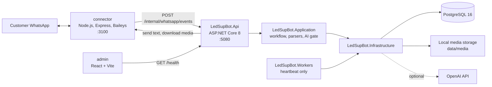
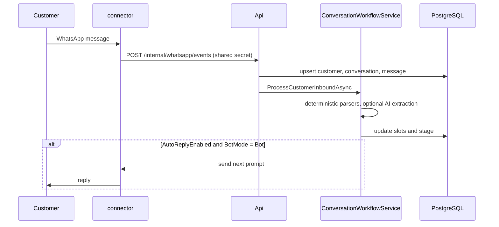

<div align="center">

# LedSupBot

**WhatsApp intake bot that turns LED-screen support chats into structured technical support cases.**
<br/>
<sub>LED ekran destek yazışmalarını yapılandırılmış teknik destek vakalarına dönüştüren WhatsApp karşılama botu.</sub>


<p><a href="#english">English</a> · <a href="#turkce">Türkçe</a></p>

</div>

| | |
|---|---|
| **Type · Tür** | Backend service + WhatsApp connector · Backend servisi + WhatsApp bağlayıcısı |
| **Status · Durum** | Prototype under active development; this README documents the `master` branch · Aktif geliştirilen prototip; bu README `master` dalını belgeler |
| **Stack · Teknoloji** | .NET 8, ASP.NET Core minimal API, EF Core 8 + Npgsql, PostgreSQL 16, Node.js + Baileys, OpenAI (optional), React + Vite shell |
| **Category · Kategori** | Portfolio / Prototype · Portfolyo / Prototip |

> [!WARNING]
> WhatsApp access uses the unofficial [Baileys](https://github.com/WhiskeySockets/Baileys) linked-device library, not the Meta-approved Cloud API. This carries Terms-of-Service and account-ban risk. Automatic replies are off by default (`Workflow:AutoReplyEnabled=false`).
>
> **TR —** WhatsApp erişimi Meta onaylı Cloud API değil, resmî olmayan Baileys bağlı cihaz kütüphanesiyle yapılır. Kullanım koşulları ve hesap kapatılma riski vardır. Otomatik yanıtlar varsayılan olarak kapalıdır (`Workflow:AutoReplyEnabled=false`).

---

<a id="english"></a>

## Overview

Customers of an LED screen business usually report faults over WhatsApp. Before a technician can help, the same facts have to be collected every time: screen width and height, photos of the panel label, receiver card count, whether the configuration connection works, and AnyDesk access. LedSupBot receives those WhatsApp messages, stores them in PostgreSQL, and runs a deterministic, slot-based workflow that asks for each missing fact in Turkish. When everything is collected it writes a case summary and hands the conversation over to a human.

Parsing is deterministic first. OpenAI structured extraction is called only when the text looks technical and the parsers could not resolve it, and the result is validated against a confidence threshold before it can fill a slot.

## Features

| Area | Capability | Where |
|---|---|---|
| WhatsApp ingest | Node.js sidecar (Express + Baileys) with QR pairing, local session, webhook to the API, `X-Connector-Secret` shared secret checked with constant-time comparison | `connector/src/`, `src/LedSupBot.Api/Program.cs` |
| Persistence | Customers, conversations, messages, support cases and slot tables in PostgreSQL; duplicate webhook events ignored via `ExternalMessageId` | `src/LedSupBot.Infrastructure/Persistence/` |
| Intake workflow | Stage resolver over collected slots: screen size → panel label photos → receiver count → config connection → config example → AnyDesk → summary → human handoff | `src/LedSupBot.Application/Workflow/` |
| Deterministic parsers | Screen size (cm/m with confirmation), receiver count, config confirmation, AnyDesk ID | `Workflow/Parsing/` |
| AI extraction (optional) | OpenAI `chat/completions` with JSON schema, gated for cost, validated by confidence (default 0.85), audited to `AiExtractionResults` | `Workflow/Ai/`, `Infrastructure/OpenAi/` |
| Human takeover | A message sent manually from the phone switches the conversation from `Bot` to `Human`; the bot never replies outside `Bot` mode | `WhatsApp/WhatsAppInboundEventHandler.cs`, `ConversationBotPolicy.cs` |
| Media pipeline | Panel-label photos downloaded via the connector, size-limited, content-sniffed with ImageSharp (JPEG/PNG/WebP), stored privately under opaque keys | `Infrastructure/Media/`, `docs/MEDIA-STORAGE.md` |
| Operations | `/health` (self + PostgreSQL), Swagger in Development, global exception middleware, connector log masking | `Api/`, `connector/src/observability.js` |
| Admin web | React 19 + Vite shell that only shows API health | `admin/` |
| Workers | Hosted-service skeleton (heartbeat only, no jobs yet) | `src/LedSupBot.Workers/` |

## Architecture



<sub>Arrows follow project references and HTTP calls in the code. Dashed: used only when `OPENAI_API_KEY` is set.</sub>

### Inbound message flow



## Repository structure

```text
led-sup-bot/
├── src/
│   ├── LedSupBot.Api/             # minimal API endpoints, health, Swagger, exception middleware
│   ├── LedSupBot.Application/     # WhatsApp event handling, workflow, parsers, AI gate/validator
│   ├── LedSupBot.Domain/          # entities, enums (ConversationStage, BotMode, ...), PhoneNumber
│   ├── LedSupBot.Infrastructure/  # EF Core + Npgsql, migrations, OpenAI client, media, connector client
│   └── LedSupBot.Workers/         # hosted-service skeleton
├── tests/
│   ├── LedSupBot.UnitTests/       # xUnit: parsers, AI extraction, mappers, media
│   └── LedSupBot.IntegrationTests/# xUnit + Testcontainers PostgreSQL + WebApplicationFactory
├── connector/                     # Baileys WhatsApp sidecar (Node.js, node:test)
├── admin/                         # React + TypeScript + Vite shell
├── docs/                          # phase documents (FAZ1–FAZ4.5), decisions, media storage
├── docker-compose.yml             # postgres:16-alpine
├── global.json                    # .NET SDK 8.0.424 (rollForward latestFeature)
└── .env.example                   # variable checklist with placeholders
```

## Data model

`Customer` 1-N `Conversation` 1-N `Message`. Each conversation has one `TechnicalSupportCase` that owns the slot records: `ScreenInformation`, `ReceiverInformation`, `PanelLabelPhoto`, `ConfigConnectionInfo`, `AnyDeskInformation`, plus `AiExtractionResult` audit rows. Schema is created by the EF Core migration `20260831132529_InitialCreate`; migrations are not applied at startup.

## Setup

**Prerequisites:** .NET SDK 8.0.4xx, Node.js 20+, Docker Desktop (PostgreSQL and integration tests), `dotnet-ef`, a WhatsApp account for linked-device pairing, optionally an OpenAI API key.

```powershell
docker compose up -d
$env:DATABASE_CONNECTION_STRING = "Host=localhost;Port=5432;Database=led_sup_bot;Username=postgres;Password=<local-password>"
$env:WHATSAPP_CONNECTOR_ENABLED = "true"
$env:WHATSAPP_CONNECTOR_SHARED_SECRET = "<shared-secret>"
# optional
$env:OPENAI_API_KEY = "<openai-key>"

dotnet ef database update --project src/LedSupBot.Infrastructure --startup-project src/LedSupBot.Api
```

The API reads process environment variables (flat names such as `DATABASE_CONNECTION_STRING` are mapped to configuration keys by `EnvironmentVariableBridge`); it does not load `.env` files. Use the local credentials from `docker-compose.yml`.

## Run

```powershell
# API: http://localhost:5080, Swagger at /swagger, health at /health
dotnet run --project src/LedSupBot.Api --launch-profile http

# Connector (set CONNECTOR_SHARED_SECRET in connector/.env to the same secret)
cd connector; Copy-Item .env.example .env; npm install; npm start
# scan the QR code: WhatsApp > Linked devices > Link a device

# Admin shell: http://localhost:5173
cd admin; Copy-Item .env.example .env; npm install; npm run dev
```

Keep `WORKFLOW_AUTO_REPLY_ENABLED=false` until the flow has been checked manually. The WhatsApp session lives in `connector/.sessions/` (git-ignored) and must be paired again on each machine.

## Testing and CI

```powershell
dotnet test LedSupBot.sln --configuration Release   # integration tests need Docker
cd connector; npm test
```

`.github/workflows/ci.yml` builds and tests the .NET solution and builds the admin app on every push and pull request. **On the current `master` the CI runs fail:** `LedSupBot.UnitTests` does not compile because `LocalMediaStorageTests` calls the `internal` method `LocalMediaStorage.SanitizeKeySegment` and the test project has no `InternalsVisibleTo` access. This was reproduced locally with `dotnet test tests/LedSupBot.UnitTests`. Integration tests and the connector tests were not run for this README.

## Engineering notes

- **Backend owns the workflow.** `ConversationStage` is derived from stored slots by `WorkflowStageResolver`, so a restart or a duplicate event cannot skip a step.
- **Deterministic first, AI second.** `AiExtractionGate` skips OpenAI for non-technical text or when parsers are fully confident; any AI failure or timeout falls back to the parsers.
- **Safe by default.** Auto-replies, the connector client and OpenAI are each disabled unless configured; `Unavailable*` implementations are registered instead.
- **Idempotent ingest.** Messages are unique by WhatsApp message id; image messages without stored media are retried when the event is redelivered.
- **Privacy.** Media keys are `cases/{caseId}/{guid}.ext`, never phone numbers; the connector masks JIDs in logs.

## Limitations

- CI is red on `master` (unit test compile error, see above).
- Sending the config example image is not implemented in the connector client (`SendImageMessageAsync` throws `NotSupportedException`); the error is caught.
- `LedSupBot.Workers` and the admin web are skeletons. There is no operator UI on `master`.
- WhatsApp Cloud API and `Storage:*` settings exist in configuration but have no implementation; only the Baileys connector is used.
- Media retention cleanup is not implemented (`MEDIA_RETENTION_DAYS` is read but no job deletes files).
- `SixLabors.ImageSharp` 3.1.7 has known security advisories (NuGet audit warnings NU1902/NU1903); upgrade recommended.
- No license file.

## Status

Prototype. Later work (operator desktop app, knowledge retrieval, panel package delivery, a different AI provider) exists only on open pull-request branches and is intentionally not described here until it is merged.

---

<a id="turkce"></a>

## Genel Bakış

LED ekran işletmesinin müşterileri arızaları genellikle WhatsApp üzerinden bildirir. Teknisyenin yardım edebilmesi için her seferinde aynı bilgiler toplanmalıdır: ekran genişliği ve yüksekliği, panel etiketi fotoğrafları, alıcı kart sayısı, konfigürasyon bağlantısının çalışıp çalışmadığı ve AnyDesk erişimi. LedSupBot bu WhatsApp mesajlarını alır, PostgreSQL'e kaydeder ve eksik her bilgiyi Türkçe olarak isteyen deterministik, slot tabanlı bir iş akışı çalıştırır. Tüm bilgiler toplandığında vaka özetini yazar ve konuşmayı bir insana devreder.

Ayrıştırma önce deterministiktir. OpenAI yapılandırılmış çıkarımı yalnızca metin teknik görünüyorsa ve ayrıştırıcılar sonucu çözemediyse çağrılır; sonuç bir slotu doldurmadan önce güven eşiğine göre doğrulanır.

## Özellikler

| Alan | Yetenek | Konum |
|---|---|---|
| WhatsApp alımı | QR eşleme, yerel oturum, API'ye webhook ve sabit süreli karşılaştırılan `X-Connector-Secret` paylaşılan sırrı ile Node.js yan servisi (Express + Baileys) | `connector/src/`, `src/LedSupBot.Api/Program.cs` |
| Kalıcılık | Müşteri, konuşma, mesaj, destek vakası ve slot tabloları PostgreSQL'de; tekrar eden webhook olayları `ExternalMessageId` ile yok sayılır | `src/LedSupBot.Infrastructure/Persistence/` |
| Karşılama iş akışı | Toplanan slotlara göre aşama çözümü: ekran boyutu → panel etiketi fotoğrafları → alıcı sayısı → konfigürasyon bağlantısı → örnek konfigürasyon → AnyDesk → özet → insana devir | `src/LedSupBot.Application/Workflow/` |
| Deterministik ayrıştırıcılar | Ekran boyutu (cm/m, gerekirse teyit), alıcı sayısı, konfigürasyon teyidi, AnyDesk ID | `Workflow/Parsing/` |
| AI çıkarımı (isteğe bağlı) | JSON şemalı OpenAI `chat/completions`; maliyet için kapılı, güvene göre doğrulanır (varsayılan 0.85), `AiExtractionResults` tablosuna denetim kaydı yazılır | `Workflow/Ai/`, `Infrastructure/OpenAi/` |
| İnsan devralması | Telefondan elle gönderilen bir mesaj konuşmayı `Bot` modundan `Human` moduna alır; bot `Bot` modu dışında asla yanıt vermez | `WhatsApp/WhatsAppInboundEventHandler.cs`, `ConversationBotPolicy.cs` |
| Medya hattı | Panel etiketi fotoğrafları connector üzerinden indirilir, boyut sınırına tabi tutulur, ImageSharp ile içerik tespiti yapılır (JPEG/PNG/WebP) ve opak anahtarlarla gizli olarak saklanır | `Infrastructure/Media/`, `docs/MEDIA-STORAGE.md` |
| Operasyon | `/health` (süreç + PostgreSQL), Development ortamında Swagger, global exception middleware, connector loglarında maskeleme | `Api/`, `connector/src/observability.js` |
| Admin web | Yalnızca API sağlık durumunu gösteren React 19 + Vite iskeleti | `admin/` |
| Workers | Hosted service iskeleti (yalnızca heartbeat, henüz iş yok) | `src/LedSupBot.Workers/` |

## Mimari

Diyagramlar yukarıdaki İngilizce bölümle aynıdır (etiketler teknik tanımlayıcı olduğu için İngilizce bırakıldı): [mimari ve mesaj akışı](#english). Oklar koddaki proje referanslarını ve HTTP çağrılarını izler; kesikli ok yalnızca `OPENAI_API_KEY` tanımlıysa kullanılır.

## Depo yapısı

```text
led-sup-bot/
├── src/
│   ├── LedSupBot.Api/             # minimal API uç noktaları, health, Swagger, exception middleware
│   ├── LedSupBot.Application/     # WhatsApp olay işleme, iş akışı, ayrıştırıcılar, AI kapısı/doğrulayıcı
│   ├── LedSupBot.Domain/          # varlıklar, enum'lar (ConversationStage, BotMode, ...), PhoneNumber
│   ├── LedSupBot.Infrastructure/  # EF Core + Npgsql, migration'lar, OpenAI istemcisi, medya, connector istemcisi
│   └── LedSupBot.Workers/         # hosted service iskeleti
├── tests/
│   ├── LedSupBot.UnitTests/       # xUnit: ayrıştırıcılar, AI çıkarımı, eşleyiciler, medya
│   └── LedSupBot.IntegrationTests/# xUnit + Testcontainers PostgreSQL + WebApplicationFactory
├── connector/                     # Baileys WhatsApp yan servisi (Node.js, node:test)
├── admin/                         # React + TypeScript + Vite iskeleti
├── docs/                          # faz dokümanları (FAZ1–FAZ4.5), kararlar, medya depolama
├── docker-compose.yml             # postgres:16-alpine
├── global.json                    # .NET SDK 8.0.424 (rollForward latestFeature)
└── .env.example                   # yer tutuculu değişken listesi
```

## Veri modeli

`Customer` 1-N `Conversation` 1-N `Message`. Her konuşmanın, slot kayıtlarına sahip tek bir `TechnicalSupportCase` kaydı vardır: `ScreenInformation`, `ReceiverInformation`, `PanelLabelPhoto`, `ConfigConnectionInfo`, `AnyDeskInformation` ve `AiExtractionResult` denetim kayıtları. Şema `20260831132529_InitialCreate` EF Core migration'ı ile oluşturulur; migration'lar uygulama açılışında otomatik uygulanmaz.

## Kurulum

**Ön koşullar:** .NET SDK 8.0.4xx, Node.js 20+, Docker Desktop (PostgreSQL ve entegrasyon testleri için), `dotnet-ef`, bağlı cihaz eşlemesi için bir WhatsApp hesabı, isteğe bağlı olarak OpenAI API anahtarı.

```powershell
docker compose up -d
$env:DATABASE_CONNECTION_STRING = "Host=localhost;Port=5432;Database=led_sup_bot;Username=postgres;Password=<yerel-parola>"
$env:WHATSAPP_CONNECTOR_ENABLED = "true"
$env:WHATSAPP_CONNECTOR_SHARED_SECRET = "<paylaşılan-sır>"
# isteğe bağlı
$env:OPENAI_API_KEY = "<openai-anahtarı>"

dotnet ef database update --project src/LedSupBot.Infrastructure --startup-project src/LedSupBot.Api
```

API süreç ortam değişkenlerini okur (`DATABASE_CONNECTION_STRING` gibi düz adlar `EnvironmentVariableBridge` ile yapılandırma anahtarlarına eşlenir); `.env` dosyası yüklemez. Yerel kimlik bilgileri için `docker-compose.yml` dosyasına bakın.

## Çalıştırma

```powershell
# API: http://localhost:5080, Swagger /swagger, health /health
dotnet run --project src/LedSupBot.Api --launch-profile http

# Connector (connector/.env içindeki CONNECTOR_SHARED_SECRET aynı sır olmalı)
cd connector; Copy-Item .env.example .env; npm install; npm start
# QR kodu okutun: WhatsApp > Bağlı cihazlar > Cihaz bağla

# Admin iskeleti: http://localhost:5173
cd admin; Copy-Item .env.example .env; npm install; npm run dev
```

Akış elle kontrol edilene kadar `WORKFLOW_AUTO_REPLY_ENABLED=false` bırakın. WhatsApp oturumu `connector/.sessions/` altında tutulur (git'e eklenmez) ve her makinede yeniden eşlenmelidir.

## Test ve CI

```powershell
dotnet test LedSupBot.sln --configuration Release   # entegrasyon testleri Docker gerektirir
cd connector; npm test
```

`.github/workflows/ci.yml` her push ve pull request'te .NET çözümünü derleyip test eder ve admin uygulamasını derler. **Mevcut `master` dalında CI başarısızdır:** `LocalMediaStorageTests`, `internal` olan `LocalMediaStorage.SanitizeKeySegment` metodunu çağırdığı ve test projesinin `InternalsVisibleTo` erişimi olmadığı için `LedSupBot.UnitTests` derlenmez. Bu durum `dotnet test tests/LedSupBot.UnitTests` ile yerelde de doğrulandı. Entegrasyon testleri ve connector testleri bu README için çalıştırılmadı.

## Mühendislik notları

- **İş akışının sahibi backend'dir.** `ConversationStage`, kayıtlı slotlardan `WorkflowStageResolver` ile türetilir; yeniden başlatma veya tekrar eden bir olay adım atlatamaz.
- **Önce deterministik, sonra AI.** `AiExtractionGate`, teknik olmayan metinlerde veya ayrıştırıcılar tam eminse OpenAI'ı çağırmaz; AI hatası veya zaman aşımında ayrıştırıcılara geri dönülür.
- **Varsayılan olarak güvenli.** Otomatik yanıt, connector istemcisi ve OpenAI yapılandırılmadıkça kapalıdır; yerlerine `Unavailable*` uygulamaları kaydedilir.
- **Idempotent alım.** Mesajlar WhatsApp mesaj kimliğine göre tekildir; medyası kaydedilmemiş görsel mesajlar olay yeniden geldiğinde tekrar işlenir.
- **Gizlilik.** Medya anahtarları `cases/{caseId}/{guid}.ext` biçimindedir, asla telefon numarası içermez; connector loglarda JID'leri maskeler.

## Sınırlamalar

- `master` dalında CI kırmızıdır (birim testi derleme hatası, yukarıya bakın).
- Örnek konfigürasyon görselinin gönderimi connector istemcisinde uygulanmamıştır (`SendImageMessageAsync`, `NotSupportedException` fırlatır); hata yakalanır.
- `LedSupBot.Workers` ve admin web iskelet aşamasındadır. `master` dalında operatör arayüzü yoktur.
- WhatsApp Cloud API ve `Storage:*` ayarları yapılandırmada bulunur ancak uygulaması yoktur; yalnızca Baileys connector kullanılır.
- Medya saklama süresi temizliği uygulanmamıştır (`MEDIA_RETENTION_DAYS` okunur ama dosya silen bir iş yoktur).
- `SixLabors.ImageSharp` 3.1.7 için bilinen güvenlik bildirimleri vardır (NuGet audit uyarıları NU1902/NU1903); güncelleme önerilir.
- Lisans dosyası yoktur.

## Durum

Prototip. Sonraki çalışmalar (operatör masaüstü uygulaması, bilgi erişimi, panel paketi teslimi, farklı bir AI sağlayıcısı) yalnızca açık pull request dallarında bulunur ve birleştirilene kadar bilinçli olarak burada anlatılmaz.
