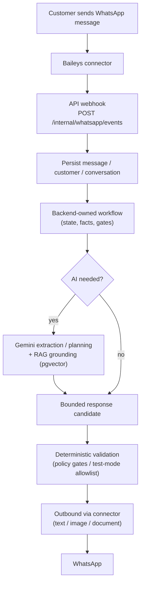
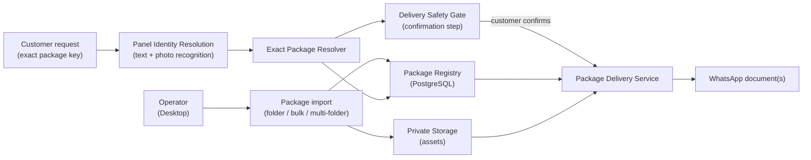

# LedSupBot

<p align="center">
  🌐 <strong>English</strong> &nbsp;|&nbsp; <a href="README.tr.md">🇹🇷 Türkçe</a>
</p>

> WhatsApp tabanlı LED teknik destek platformu &nbsp;→&nbsp; [🇹🇷 Türkçe README](README.tr.md)

LedSupBot is a **WhatsApp-based LED technical support platform** that combines:

- a **Baileys linked-device connector** (unofficial, Node.js sidecar),
- an **ASP.NET Core backend** with clean-architecture boundaries,
- **PostgreSQL persistence** with EF Core (plus pgvector vector search),
- **RAG-based technical knowledge retrieval**,
- **Gemini-powered extraction and response planning** with deterministic boundaries,
- a **WPF operator desktop application** (`LedSupport`), and
- **deterministic panel-package delivery** over WhatsApp.

> ⚠️ **WhatsApp integration disclaimer** — The WhatsApp integration uses
> [Baileys](https://github.com/WhiskeySockets/Baileys) on a personal linked device.
> It is **not** an official Meta API and carries **ToS / account-ban risk**.
> WhatsApp session state is kept local and is never committed to Git.

---

## Overview

LedSupBot lets a technical support team run LED-panel diagnostics and file delivery from WhatsApp conversations:

1. A **customer** messages the support WhatsApp number.
2. The **Baileys connector** (running on the operator's machine) picks up the event and forwards it to the internal API.
3. The **API** persists the message, customer and conversation, then runs a **backend-owned workflow**.
4. The workflow may use **Gemini** for bounded extraction and phrasing, grounded by **RAG retrieval** over technical documents (pgvector).
5. When the panel identity is known, the **panel package system** resolves the **exact package** and, after a **customer confirmation gate**, delivers the package assets as **WhatsApp documents**.
6. The operator follows everything in the **LedSupport desktop app**, which stays in sync via **SignalR** and the admin API.

The backend — **not the AI** — remains authoritative for workflow state, facts, package delivery and security decisions.

---

## Key Features

| Area | Capability | Status |
|---|---|---|
| WhatsApp linked-device integration | Baileys sidecar (`connector/`) with QR pairing, session persistence, webhook forwarding | ✅ Implemented — *unofficial, manual pairing required* |
| Backend API | ASP.NET Core 8 minimal APIs, Swagger (`/swagger`), health checks (`/health`) | ✅ Implemented |
| Persistence | PostgreSQL 16 + EF Core 8 code-first, Npgsql, checked-in migrations, auto-migrate at startup | ✅ Implemented |
| Technical knowledge / RAG | PDF ingestion → chunking → Gemini embeddings → pgvector cosine retrieval | ✅ Implemented |
| AI response pipeline | Gemini extraction, conversation planning, web grounding, image analysis — bounded by deterministic gates | ✅ Implemented |
| Realtime operator sync | SignalR hub (`/hubs/admin`) pushes message / operator-state / WhatsApp-status events | ✅ Implemented |
| Operator desktop app | WPF `LedSupport` — conversation list, composer, panel files, training data, pairing | ✅ Implemented |
| Panel package import | Single-folder, bulk-folder and multi-folder selection import | ✅ Implemented |
| Panel package delivery | Exact package resolution → safety gate → confirmation → WhatsApp document delivery | ✅ Automated test coverage — *real WhatsApp E2E is manual* |
| Teacher Mode | AI training data collection + operator feedback (approve / reject / edit) | ✅ Implemented |
| Verified case memory | Operators create / verify / reject reusable support-case memories | ✅ Implemented |
| Admin web dashboard | React + TypeScript (Vite) foundation | ⚠️ Foundation shell only |
| Speech services | STT / TTS interfaces exist; connector supports outbound audio | ⚠️ Providers not configured by default |
---

## Architecture

```mermaid
flowchart LR
    C(["Customer<br/>WhatsApp"])
    B["Baileys Connector<br/>(Node.js sidecar)"]
    API["ASP.NET Core API"]
    DB[("PostgreSQL<br/>+ pgvector")]
    AI["Gemini"]
    SIG["SignalR<br/>(/hubs/admin)"]
    DESK["LedSupport Desktop<br/>(WPF operator app)"]
    PKG["Private Media Storage<br/>(panel package assets)"]

    C <-->|"WhatsApp messages / documents"| B
    B <-->|"webhook events / send"| API
    API <--> DB
    API <-->|"embeddings + retrieval"| DB
    API <-->|"extraction / planning / grounding"| AI
    API --|"realtime events"| SIG
    SIG -.->|"updates"| DESK
    DESK <-->|"admin REST + SignalR"| API
    API <--> PKG
```

- **Baileys connector** is a thin loopback sidecar: it never decides what to reply, deliver, or store.
- **Backend workflow** services persist and validate state; AI only contributes bounded extraction, grounding and phrasing.
- **Desktop** and **admin web** consume the same admin API; realtime updates arrive over SignalR.

---

## How It Works

### WhatsApp Message Flow



Key invariants:

- **Backend owns the workflow.** The AI cannot directly change workflow state, customer facts, package truth, or delivery targets.
- **AI is bounded.** Extraction results go through validation gates; deterministic rules run first (`PreferDeterministicFirst=true`).
- **Auto-reply is opt-in.** `Workflow:AutoReplyEnabled` controls whether the bot may send anything. Inbound coalescing and natural-timing delays are configurable.
- **Self-messaging is protected.** Group chats and self-sent loops are ignored; the connector reports self-JIDs so the bot never replies to itself.

### Technical Knowledge / RAG

Technical documents (PDFs) are ingested by `LedSupBot.KnowledgeCli`:

1. Native text extraction with **PdfPig**; if quality is poor, a **Gemini vision / OCR fallback** reruns the page extraction.
2. Documents are metadata-tagged (manufacturer, product type, product family, model) and split into chunks.
3. Chunks are embedded with **Gemini embeddings** (768 dimensions) and stored in **pgvector**.
4. Retrieval uses **cosine similarity** with optional metadata filters and returns grounded passages with page/section references.

The knowledge corpus itself (PDF files) lives locally — `knowledge/raw/` is gitignored and is not part of the repository.

---

## Panel Package System

Panel packages make LED-panel support deterministic: the customer states their panel, the bot resolves the *exact* matching package, and the operator ships its assets over WhatsApp.

### Package Identity and Naming Convention

**The folder / package name is the package identity.** Inner file names are ordinary assets and are never used as identity.

Format: `P{Pitch}+{Chipset}+{Decoder}`

| Example package folder | Family |
|---|---|
| `P2.5+1065S+2012` | P2.5 / 1065S / 2012 |
| `P1.86+1065+2018` | P1.86 / 1065 / 2018 |
| `P3.076+1065AP+1012` | P3.076 / 1065AP / 1012 |
| `P1.53+FM6126A+138` | P1.53 / FM6126A / 138 |

Internally, each package is stored under a canonical key such as `P2.5-1065S-2012` (normalized, uppercase).

A package may contain **multiple files**. Recognized asset types:

- **Firmware** — `.hex`
- **Receiver configuration** — `.rcvbp`

Assets are stored through the existing private media-storage architecture (SHA-256 hashed, versioned, size limits enforced) and are never exposed through public paths.

### Panel Package Delivery Flow



Delivery rules enforced by code:

- The customer's package key must resolve to **exactly one** package (`ExactMatch`). Ambiguity, missing information, inactive or incomplete packages are **not** delivered.
- Delivery is blocked for a package whose content changed after the confirmation, or when the case is closed / identity conflicted.
- A **confirmation state** (request → confirm / reject / invalidate) precedes any file send.
- Delivery is serialized **per case** and requires `AutoReplyEnabled`; customers can never select an arbitrary storage key, path or asset ID.
---

## Desktop Operator Application

**LedSupport Desktop** (`src/LedSupBot.Desktop`, WPF / .NET 8) is the main operator console:

- **Conversation list** with BOT / HUMAN / PAUSED mode badges and search/filter
- **Realtime chat view** — inbound and outbound messages updated over SignalR
- **Composer** for technician replies
- **Workflow indicators** — support steps, panel identity state, AnyDesk alerts
- **Panel file management** — create/edit packages, upload firmware (`.hex`) and receiver configs (`.rcvbp`), activate / archive / rollback
- **Folder import** — single folder, bulk import (auto-discovery of child folders) and multi-folder selection
- **Teacher Mode** — review AI drafts and provide training feedback
- **Training data view** — browse AI training examples with filters
- **Case memory review** — draft / verify / reject reusable case memories
- **WhatsApp pairing** — in-app QR pairing and session reset
- **Local service manager** — optionally auto-starts PostgreSQL, the API and the connector

## Screenshots

> The screenshots below are genuine captures from the current development cycle. They are kept as-is for orientation and will be refreshed after final manual release verification.

| Screen | Image |
|---|---|
| Login |  |
| Main window |  |
| Active conversation |  |
| Technical panel |  |

## Project Structure

```text
led-sup-bot/
├─ src/
│  ├─ LedSupBot.Api/             # ASP.NET Core 8 API — REST, SignalR, Swagger, health checks
│  ├─ LedSupBot.Application/     # Use cases, workflows, panel files, admin, AI boundaries
│  ├─ LedSupBot.Domain/          # Entities, value objects, enums, port interfaces
│  ├─ LedSupBot.Infrastructure/  # EF Core / Npgsql / pgvector, Gemini, storage, knowledge
│  ├─ LedSupBot.Desktop/         # WPF operator application (LedSupport)
│  ├─ LedSupBot.Workers/         # Background worker services
│  └─ LedSupBot.KnowledgeCli/    # Technical knowledge import / search CLI
├─ connector/                    # Unofficial Baileys WhatsApp sidecar (Node.js)
├─ admin/                        # React + TypeScript (Vite) admin web foundation
├─ tests/
│  ├─ LedSupBot.UnitTests/       # .NET unit tests (xUnit)
│  └─ LedSupBot.IntegrationTests/# .NET integration tests (Testcontainers PostgreSQL)
├─ scripts/                      # QA / E2E helper scripts (SQL + PowerShell)
├─ docs/                         # Decision records, phase docs, images, workflow policy
├─ knowledge/                    # Local knowledge corpus (gitignored) + cache
├─ screenshots/                  # Original UI captures
├─ docker-compose.yml            # PostgreSQL 16 + pgvector (pgvector/pgvector:pg16)
├─ .env.example                  # Environment variable checklist
├─ appsettings.Local.example.json# Optional local configuration template
└─ LedSupBot.sln                 # Solution file
```

## Technology Stack

| Area | Technology |
|---|---|
| Backend | ASP.NET Core / C# / .NET 8 (SDK pinned via `global.json`) |
| Desktop | WPF / .NET 8 (`net8.0-windows`) |
| Database | PostgreSQL 16 (Docker image `pgvector/pgvector:pg16`) |
| ORM / Migrations | EF Core 8 + Npgsql, checked-in migrations |
| Vector search | pgvector (cosine distance) |
| WhatsApp | Baileys 6.7.x Node sidecar — *unofficial* |
| Realtime | SignalR (`/hubs/admin`) |
| AI | Google Gemini (extraction, embeddings, planning, web grounding, image analysis) |
| Knowledge extraction | PdfPig + Gemini vision/OCR fallback |
| Admin web | React 19 + TypeScript + Vite |
| Tests (.NET) | xUnit, Microsoft.NET.Test.Sdk, Testcontainers PostgreSQL |
| Tests (connector) | Node built-in test runner (`node --test`) |
| Tests (admin) | Vitest + Oxlint |
| CI | GitHub Actions (`.github/workflows/ci.yml`) — builds .NET solution and admin app |

## Getting Started

### Prerequisites

| Tool | Notes |
|---|---|
| Git | Any recent version |
| .NET SDK | 8.0.x (repository pins `8.0.424` in `global.json`) |
| Node.js | 20+ (connector); admin CI uses Node 22 |
| npm | Bundled with Node.js |
| Docker Desktop | For PostgreSQL (`docker-compose.yml`) and integration tests (Testcontainers) |
| WhatsApp account | For the linked device + QR pairing |
| Google Gemini API key | For AI features and knowledge embeddings |

### 1. Clone

```powershell
git clone https://github.com/HalilMertDeveli/led-sup-bot.git
cd led-sup-bot
```

### 2. Start PostgreSQL

```powershell
docker compose up -d
```

Database: `led_sup_bot`, user/password `postgres`/`postgres` on `localhost:5432`. Data persists in the Docker volume `led_sup_bot_pgdata`.

### 3. Configure the API

Copy `.env.example` as a checklist, then set the required variables in the shell that runs the API:

```powershell
$env:DATABASE_CONNECTION_STRING = "Host=localhost;Port=5432;Database=led_sup_bot;Username=postgres;Password=postgres"
$env:GEMINI_API_KEY = "<your-key>"
$env:ASPNETCORE_ENVIRONMENT = "Development"
```

> The API reads **process environment variables** (it does not load a `.env` file itself; the desktop app can load `.env` for the services it starts). Pending EF Core migrations are **applied automatically at startup** when a database is configured.

Optional API variables can be copied from `.env.example` (connector secret, admin dashboard, media storage, workflow flags …).
### 4. Configure the connector

```powershell
cd connector
Copy-Item .env.example .env
```

Set `CONNECTOR_SHARED_SECRET` to the **same** value as the API's `WHATSAPP_CONNECTOR_SHARED_SECRET`. The connector listens on port `3100` and posts inbound events to `ASPNET_WEBHOOK_URL` (default `http://127.0.0.1:5080/internal/whatsapp/events`).

---

## Running the Project

### API

```powershell
# from the repository root
dotnet run --project src/LedSupBot.Api --launch-profile http
```

- API: <http://localhost:5080>
- Swagger: <http://localhost:5080/swagger>
- Health: <http://localhost:5080/health>

### Connector

```powershell
cd connector
npm install
npm start
```

On first run, scan the QR code printed in the terminal: **WhatsApp → Linked devices → Link a device**. The WhatsApp session is stored locally under `connector/.sessions/` (gitignored, never committed).

> Never run automatic replies before manual verification. Keep `Workflow:AutoReplyEnabled=false` until a controlled test confirms behavior.

### Desktop operator app

```powershell
# from the repository root
dotnet run --project src/LedSupBot.Desktop
```

The desktop app can auto-start PostgreSQL, the API and the connector (see `src/LedSupBot.Desktop/appsettings.json`: `AutoStartPostgreSql`, `AutoStartApi`, `AutoStartConnector`), then logs in against the admin API on port `5080`.

### Knowledge CLI

Run from the repository root (it reads the API connection configuration):

```powershell
# status of the knowledge base
dotnet run --project src/LedSupBot.KnowledgeCli -- status

# import PDFs from knowledge/raw (dry run first)
dotnet run --project src/LedSupBot.KnowledgeCli -- import --dry-run
dotnet run --project src/LedSupBot.KnowledgeCli -- import

# search the knowledge base
dotnet run --project src/LedSupBot.KnowledgeCli -- search --query "P2.5 1065S 2012"
```

### Admin web (optional, foundation)

```powershell
cd admin
Copy-Item .env.example .env
npm install
npm run dev
```

Dev server: <http://localhost:5173> (`VITE_API_BASE_URL` defaults to `http://localhost:5080`).

---

## Configuration

### API environment variables

| Variable | Purpose |
|---|---|
| `DATABASE_CONNECTION_STRING` | PostgreSQL connection string |
| `ASPNETCORE_ENVIRONMENT` | Environment (`Development`, …) |
| `GEMINI_API_KEY` / `GEMINI_MODEL` | Gemini provider key/model (default `gemini-3.6-flash`) |
| `EMBEDDING_PROVIDER` / `EMBEDDING_MODEL` / `EMBEDDING_DIMENSIONS` | Embedding provider (default Gemini, 768 dims) |
| `WHATSAPP_CONNECTOR_ENABLED` | Enable/disable the Baileys connector client |
| `WHATSAPP_CONNECTOR_BASE_URL` | Connector base URL (default `http://127.0.0.1:3100`) |
| `WHATSAPP_CONNECTOR_SHARED_SECRET` | Shared secret — must match `connector/.env` |
| `ADMIN_DASHBOARD_PASSWORD` | Admin dashboard login password (server-side only) |
| `ADMIN_SESSION_SECRET` | Secret for signing admin session cookies (>= 32 chars) |
| `MEDIA_STORAGE_ROOT` | Local private media root (default `./data/media`) |
| `STORAGE_CONNECTION_STRING` / `STORAGE_CONTAINER_NAME` | Optional external storage |
| `WORKFLOW_AUTO_REPLY_ENABLED` | Master switch for bot outbound replies |
| `WORKFLOW_NATURAL_TIMING_ENABLED` | Natural typing delays |
| `WORKFLOW_INBOUND_COALESCE_ENABLED` | Coalesce burst messages within a window |

All values must be placeholders or real local secrets — never commit real secrets.

### Connector variables

| Variable | Purpose |
|---|---|
| `PORT` | Connector port (default `3100`) |
| `CONNECTOR_SHARED_SECRET` | Shared HMAC secret — must match the API |
| `WHATSAPP_CONNECTOR_SHARED_SECRET` | Alias accepted by the connector |
| `ASPNET_WEBHOOK_URL` | Internal API webhook URL |
| `SESSION_DIR` | Session directory (default `.sessions`) |
| `LOG_LEVEL` | pino log level |

### Never commit

- `.env`, `connector/.env`, any `appsettings.Local.*.json`
- `connector/.sessions/` (WhatsApp linked-device credentials)
- `knowledge/raw/`, `knowledge/cache/`, `data/media/`
- `node_modules/`, `bin/`, `obj/`

These paths are covered by `.gitignore`.
---

## Testing

```powershell
# .NET: build + all tests (unit + integration). Integration tests use
# Testcontainers with postgres:16-alpine, so Docker must be running.
dotnet build LedSupBot.sln --configuration Release
dotnet test LedSupBot.sln --configuration Release --verbosity normal

# Connector unit tests (Node built-in test runner)
cd connector
npm test

# Admin web tests + production build
cd ..\admin
npm run test
npm run build
```

Test coverage includes: panel identity parsing and photo recognition, exact package resolution, delivery safety gate, bulk import, WhatsApp event mapping, takeover/pause/resume, workflow extraction, Gemini orchestration and privacy, RAG retrieval policy, media storage and SignalR synchronization.

> **Real WhatsApp E2E is manual.** The GitHub Actions CI builds and runs the .NET and admin test suites on `ubuntu-latest`; it does **not** perform any real WhatsApp activity. Sending messages to a real WhatsApp account requires manual QR pairing and controlled tests (for example the `/internal/whatsapp/send-text` endpoint when the connector is enabled and `Workflow:AutoReplyEnabled` is on).

---

## Development Workflow

Every task follows **one task → one branch → one PR**:

1. Create a branch from the correct base: `feature/<task>`, `fix/<bug>`, `docs/<documentation>`, `refactor/<task>`, `test/<task>`.
2. Implement, add tests, build, and verify.
3. Commit with a clear message; do **not** mix unrelated changes.
4. Push and open a PR against the appropriate base branch.
5. Wait for review + CI; merge only after approval.

Full policy and examples: [docs/development-workflow.md](docs/development-workflow.md).

---

## Security Notes

- **Shared secret** — the API and connector authenticate with a shared secret (`X-Connector-Secret`) using constant-time comparison. No API process accepts connector events without it.
- **No committed secrets** — `.env.example` files contain placeholders only; real API keys and passwords stay out of Git.
- **WhatsApp privacy** — linked-device session material (`connector/.sessions/`, `creds.json`, pre-keys…) is gitignored and never committed.
- **Operator authentication** — the admin surface uses a server-side password and an HttpOnly signed session cookie. The browser/desktop never receives the connector secret or the Gemini API key.
- **Deterministic delivery** — customers cannot select arbitrary storage keys, paths or asset IDs; the exact-package resolver and confirmation gate govern every file send.
- **Controlled automation** — `Workflow:AutoReplyEnabled` gates all bot outbound traffic; a test-mode allowlist limits risk during verification.
- **Media privacy** — inbound customer media is stored in private local storage, validated, and referenced by storage key only (no public URLs).

---

## Current Status

| Component | Status |
|---|---|
| ASP.NET Core API | ✅ Implemented |
| PostgreSQL + EF Core persistence | ✅ Implemented |
| pgvector RAG retrieval | ✅ Implemented |
| Gemini integration | ✅ Implemented |
| SignalR realtime sync | ✅ Implemented |
| WPF Desktop (`LedSupport`) | ✅ Implemented |
| WhatsApp connector (Baileys) | ✅ Implemented — *unofficial; manual QR pairing; real E2E manual* |
| Panel package import | ✅ Implemented |
| Panel package delivery | ✅ Automated coverage — *real WhatsApp E2E requires manual verification* |
| Teacher Mode / training data | ✅ Implemented |
| Verified case memory | ✅ Implemented |
| Admin web dashboard | ⚠️ Foundation shell only |
| Speech-to-text / text-to-speech | ⚠️ Interfaces present; providers not configured by default |

> Status is based on the current repository state and test history. It deliberately does **not** claim "real WhatsApp E2E passed" — that still needs a manual controlled run.

---

## Documentation

- [🇹🇷 Türkçe README](README.tr.md)
- [docs/development-workflow.md](docs/development-workflow.md)
- [docs/DECISIONS.md](docs/DECISIONS.md) — architecture decision records
- [docs/FAZ1-ARCHITECTURE-AUDIT.md](docs/FAZ1-ARCHITECTURE-AUDIT.md)
- [docs/FAZ2-PROJECT-FOUNDATION.md](docs/FAZ2-PROJECT-FOUNDATION.md)
- [docs/FAZ3-DATABASE.md](docs/FAZ3-DATABASE.md)
- [docs/FAZ4-PERSONAL-WHATSAPP-AUDIT.md](docs/FAZ4-PERSONAL-WHATSAPP-AUDIT.md)
- [docs/FAZ4.5-WHATSAPP-CONNECTOR.md](docs/FAZ4.5-WHATSAPP-CONNECTOR.md)
- [docs/MEDIA-STORAGE.md](docs/MEDIA-STORAGE.md)

---

## Contributing / Branch Policy

- One task → one branch → one PR (branches: `feature/*`, `fix/*`, `docs/*`, `refactor/*`, `test/*`).
- Do **not** merge your own documentation before review.
- When several tasks run in parallel, use **separate Git worktrees** so uncommitted local work is never disturbed.
- Do **not** advertise features that do not exist in the codebase, and do **not** commit secrets or WhatsApp session data.
- This repository is **not** distributed with a license file at this time; confirm licensing before external reuse.
- Every delivery attempt is persisted with checked assets (SHA-256) and message IDs.