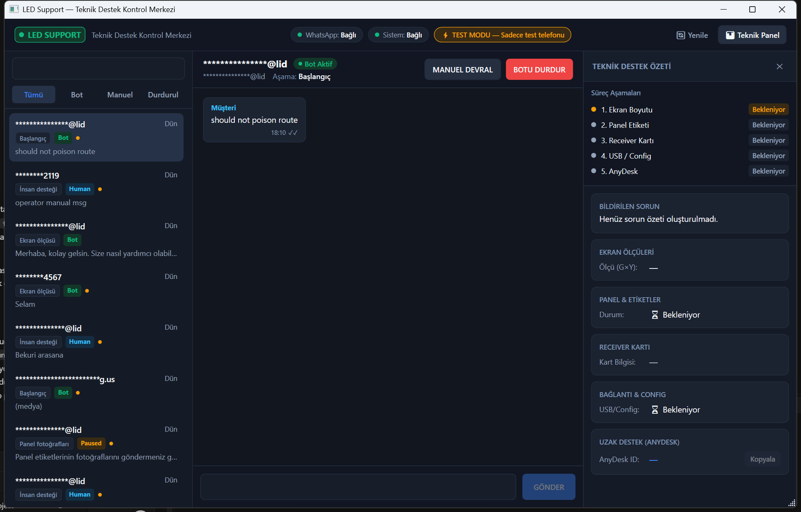
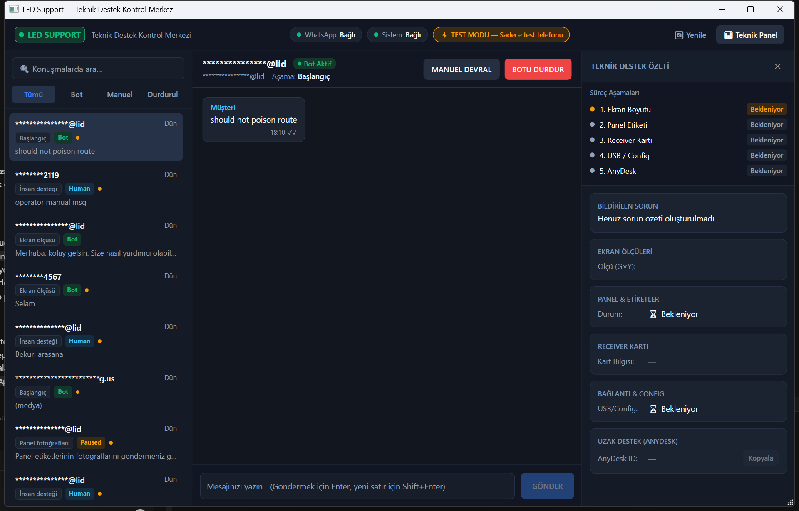
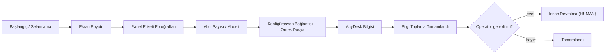
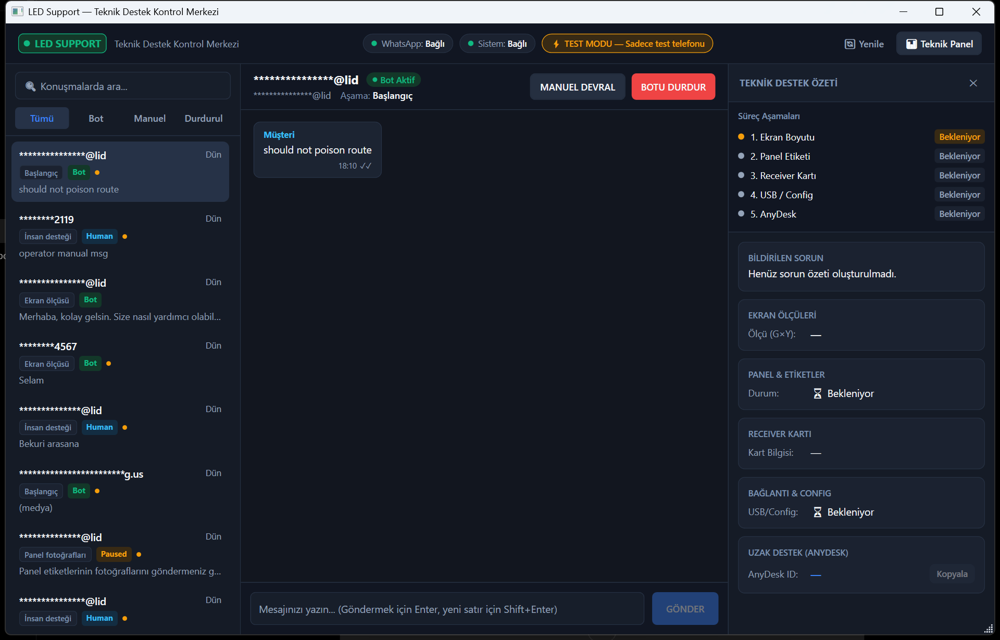
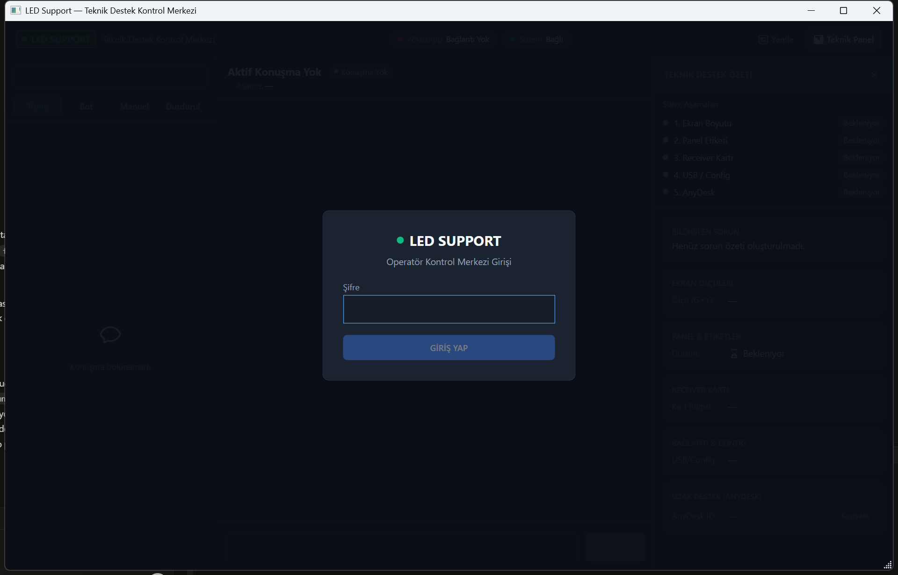

# LedSupBot

<p align="center">
  <strong>🇹🇷 Türkçe</strong> &nbsp;|&nbsp; <a href="README.en.md">🇬🇧 English</a>
</p>

> **WhatsApp üzerinden LED ekran teknik desteği.** LedSupBot; müşteri mesajlarını Baileys tabanlı bağlı cihaz bağlantısıyla karşılar, ASP.NET Core backend'de konuşmayı ve destek vakasını PostgreSQL'e işler, RAG + Gemini ile teknik bilgiye dayalı yanıtlar üretir ve operatöre WPF tabanlı LedSupport masaüstü uygulamasıyla gerçek zamanlı kontrol sağlar — doğru panel paketini (firmware + konfigürasyon) deterministik biçimde WhatsApp belgesi olarak teslim eder.

> ⚠️ **WhatsApp uyarısı:** Entegrasyon, resmî olmayan [Baileys](https://github.com/WhiskeySockets/Baileys) bağlı cihaz kütüphanesini kullanır (Meta onaylı değildir); ToS / hesap kapatılma riski taşır. WhatsApp oturum durumu yalnızca yerel saklanır ve Git'e asla gönderilmez.

---

## Neden LedSupBot?

LED panel müşterileri arızayı genellikle WhatsApp üzerinden anlatır; ekran boyutu, panel etiketi, alıcı modeli gibi teknik bilgileri toplamak ve doğru firmware/konfigürasyon dosyasını güvenli biçimde göndermek zordur. LedSupBot bu süreci şöyle çözer:

- Müşteri konuşmasını otomatik olarak **teknik destek vakasına** dönüştürür: ekran boyutu → panel etiketi → alıcı → konfigürasyon bağlantısı → AnyDesk.
- Teknik bilgiyi **RAG + Gemini** ile destekler; AI yanıtlarını deterministik kurallarla sınırlar.
- Operatör konuşmayı istediği anda **devralabilir**, duraklatabilir veya bota geri verebilir.
- Doğru **panel paketini** (firmware `.hex` + alıcı konfigürasyonu `.rcvbp`) tam eşleşme + müşteri onay kapısıyla WhatsApp belgesi olarak teslim eder.



---

## Nasıl Çalışır?

1. Müşteri, WhatsApp destek numarasına mesaj gönderir.
2. **Baileys connector** olayı yakalar ve iç API'ye webhook ile iletir (`POST /internal/whatsapp/events`).
3. Backend, mesajı / müşteriyi / konuşmayı **PostgreSQL**'e yazar.
4. **İş akışı motoru**, konuşmanın hangi destek adımında olduğuna karar verir.
5. Teknik bilgi gerektiğinde **pgvector** üzerinden LED dokümantasyonuna **RAG** erişimi yapılır.
6. **Gemini**, sınırlı çıkarım ve yanıt planlaması üretir; tüm yanıtlar deterministik doğrulama kapılarından geçer.
7. **LedSupport masaüstü** uygulaması **SignalR** ile gerçek zamanlı olarak güncellenir.
8. Operatör gerektiğinde konuşmayı **devralır** (BOT → HUMAN); bot aşamalı olarak kapanır.



---

## LED Destek İş Akışı

İş akışı aşamaları backend tarafından yönetilir (`ConversationStage`):



- Gelen görseller (panel etiketi fotoğrafları vb.) medya hattında doğrulanır ve gerekirse görsel analizden geçer.
- Panel kimliği **metin veya etiket fotoğrafından** çözülür; tam eşleşme olmadan paket teslim edilmez.
- Operatör konuşmayı **BOT / PAUSED / HUMAN** modlarıyla yönetir; her mod değişikliği denetlenir ve kaydedilir.



**Diğer ekranlar**

<table>
  <tr>
    <td></td>
    <td></td>
  </tr>
  <tr>
    <td align="center"><em>Giriş ekranı</em></td>
    <td align="center"><em>Teknik panel (açılmış)</em></td>
  </tr>
</table>

---

## Özellikler

- **WhatsApp bağlı cihaz entegrasyonu** — Baileys sidecar: QR eşleme, oturum kalıcılığı, webhook iletişimi (resmî olmayan).
- **Gerçek zamanlı operatör arayüzü** — LedSupport masaüstü; konuşma listesi, mesaj akışı, yazıcı, durum göstergeleri.
- **Konuşma kalıcılığı** — Mesajlar, müşteriler, konuşmalar ve destek vakaları PostgreSQL'de saklanır.
- **İş akışı farkındalıklı destek** — Slot tabanlı aşamalar; konuşma hangi bilginin beklendiğini bilir.
- **İnsan devralma** — Operatör konuşmayı devralabilir, duraklatabilir veya bota geri verebilir.
- **LED teknik bilgi erişimi** — PDF dokümantasyon alımı, parçalama, embedding ve pgvector ile RAG araması.
- **AI destekli yanıtlar** — Gemini destekli çıkarım ve konuşma planlaması; deterministik kapılarla sınırlı.
- **Panel kimliği tanıma** — Metin ve fotoğraf (etiket) tabanlı panel tanıma.
- **Deterministik panel paket teslimi** — `P{Pitch}+{Chipset}+{Decoder}` paket kimliği, tam eşleşme + onay kapısı, WhatsApp belge teslimi.
- **Teacher Mode** — AI yanıt taslaklarından eğitim verisi toplama ve operatör geri bildirimi (onayla / reddet / düzenle).
- **Doğrulanmış vaka belleği** — Operatörün onayladığı vaka çözümlerinin yeniden kullanılabilir belleği.
- **Koruma mekanizmaları** — Tekrarlanan mesaj filtresi, grup mesajlarını yok sayma, self-loop koruması, test modu izin listesi.

---

## Mimari

```mermaid
flowchart LR
    C(["Müşteri<br/>WhatsApp"])
    B["Baileys Connector<br/>(Node.js sidecar)"]
    API["ASP.NET Core API"]
    DB[("PostgreSQL<br/>+ pgvector")]
    AI["Gemini"]
    SIG["SignalR<br/>(/hubs/admin)"]
    DESK["LedSupport Desktop<br/>(WPF operatör uygulaması)"]
    PKG["Özel Medya Deposu<br/>(panel paket varlıkları)"]

    C <-->|"WhatsApp mesajları / belgeleri"| B
    B <-->|"webhook olayları / gönderim"| API
    API <--> DB
    API <-->|"embedding + arama"| DB
    API <-->|"çıkarım / planlama / grounding"| AI
    API --|"gerçek zamanlı olaylar"| SIG
    SIG -.->|"güncellemeler"| DESK
    DESK <-->|"admin REST + SignalR"| API
    API <--> PKG
```

- **Baileys connector** yalnızca ince bir loopback yan servisidir: ne yanıtlanacağına, ne teslim edileceğine ne de ne saklanacağına karar vermez.
- **Backend iş akışı** durumu kalıcılaştırır ve doğrular; AI yalnızca sınırlı çıkarım / grounding / ifadelemeye katkı verir.
- **LedSupport masaüstü** ve **admin web** aynı admin API'sini kullanır; gerçek zamanlı güncellemeler SignalR üzerinden gelir.
---

## Teknolojiler

| Teknoloji | Bu sistemdeki rolü |
|---|---|
| **.NET 8 / ASP.NET Core 8** | Backend API; REST uç noktaları, Swagger, sağlık kontrolleri, SignalR sunucusu |
| **C# / EF Core 8 + Npgsql** | PostgreSQL kalıcılığı; entity modeli ve sürümlü migration'lar |
| **WPF (.NET 8)** | LedSupport masaüstü operatör uygulaması (`AssemblyName: LedSupport`) |
| **MVVM** | Masaüstü katmanı `ViewModels` + `Views` (XAML) + `Converters` yapısıyla MVVM desenini kullanır |
| **SignalR** | API → masaüstü gerçek zamanlı olay akışı (mesaj, operatör durumu, WhatsApp durumu) |
| **Node.js 20+** | Baileys connector sidecar'ının çalıştırıcısı |
| **Baileys (6.7.x)** | WhatsApp bağlı cihaz protokolü — resmî olmayan, Meta onaylı değil |
| **PostgreSQL 16** | Ana veritabanı (Docker imajı `pgvector/pgvector:pg16`) |
| **pgvector** | Bilgi parçaları ve doküman raftları için vektör/kosinüs araması |
| **Google Gemini** | Sınırlı çıkarım, konuşma planlama, web grounding, görüntü analizi ve embedding üretimi |
| **RAG** | Teknik dokümantasyondan grounded bilgi çekimi (alım → parçalama → vektörleştirme → arama) |
| **PdfPig** | PDF'lerden yerel metin çıkarımı (kalite düşükse Gemini OCR/vizyon yedeği) |
| **React + TypeScript + Vite** | Admin web arayüz iskelesi (`admin/`) |
| **xUnit + Testcontainers** | .NET birim ve entegrasyon testleri (gerçek PostgreSQL) |
| **GitHub Actions** | CI: .NET çözümünü ve admin uygulamasını derler/test eder |

---

## Proje Yapısı

```text
led-sup-bot/
├─ src/
│  ├─ LedSupBot.Api/             # ASP.NET Core 8 API — REST, SignalR, Swagger, health
│  ├─ LedSupBot.Application/     # Kullanım senaryoları, iş akışları, panel dosyaları, admin
│  ├─ LedSupBot.Domain/          # Varlıklar, değer nesneleri, enum'lar, port arayüzleri
│  ├─ LedSupBot.Infrastructure/  # EF Core / Npgsql / pgvector, Gemini, depolama, bilgi alımı
│  ├─ LedSupBot.Desktop/         # WPF operatör uygulaması (LedSupport)
│  ├─ LedSupBot.Workers/         # Arka plan işçi servisleri
│  └─ LedSupBot.KnowledgeCli/    # Teknik bilgi alım / arama komut satırı aracı
├─ connector/                    # Baileys WhatsApp sidecar'ı (Node.js)
├─ admin/                        # React + TypeScript (Vite) admin web iskelesi
├─ tests/
│  ├─ LedSupBot.UnitTests/       # .NET birim testleri (xUnit)
│  └─ LedSupBot.IntegrationTests/# .NET entegrasyon testleri (Testcontainers PostgreSQL)
├─ scripts/                      # QA / E2E yardımcı betikleri (SQL + PowerShell)
├─ docs/                         # Karar kayıtları, faz dokümanları, ekran görüntüleri
├─ screenshots/                  # Özgün UI çekimleri
├─ docker-compose.yml            # PostgreSQL 16 + pgvector
├─ .env.example                  # Ortam değişkeni kontrol listesi (yer tutucular)
└─ LedSupBot.sln                 # Çözüm dosyası
```

---

## Kurulum

### Ön koşullar

| Araç | Not |
|---|---|
| Git | Herhangi bir güncel sürüm |
| .NET SDK | 8.0.x (depo `global.json` içinde `8.0.424` sabitler) |
| Node.js | 20+ (connector); admin CI Node 22 kullanır |
| Docker Desktop | PostgreSQL ve Testcontainers için |
| WhatsApp hesabı | Bağlı cihaz + QR eşleme için |
| Google Gemini API anahtarı | AI ve embedding özellikleri için |

### 1. Klonlama

```powershell
git clone https://github.com/HalilMertDeveli/led-sup-bot.git
cd led-sup-bot
```

### 2. PostgreSQL'i başlatma

```powershell
docker compose up -d
```

Veritabanı: `led_sup_bot`, kullanıcı/şifre: `postgres`/`postgres` (yerel geliştirme varsayılanı), adres: `localhost:5432`.

### 3. API ortam değişkenleri

API **süreç ortam değişkenlerini** okur; kendisi bir `.env` dosyası yüklemez. `.env.example` dosyasındaki değişken adlarını kontrol listesi olarak kullanın. Minimum yerel kurulum:

```powershell
$env:DATABASE_CONNECTION_STRING = "Host=localhost;Port=5432;Database=led_sup_bot;Username=postgres;Password=postgres"
$env:GEMINI_API_KEY = "<anahtarınız>"
$env:ASPNETCORE_ENVIRONMENT = "Development"
```

### 4. Connector yapılandırması

```powershell
cd connector
Copy-Item .env.example .env
```

`CONNECTOR_SHARED_SECRET` değerini API'nin `WHATSAPP_CONNECTOR_SHARED_SECRET` değeriyle **aynı** yapın. Connector `3100` portunu dinler ve olayları `ASPNET_WEBHOOK_URL` adresine iletir (varsayılan `http://127.0.0.1:5080/internal/whatsapp/events`).
---

## Çalıştırma

### API

```powershell
# depo kökünden
dotnet run --project src/LedSupBot.Api --launch-profile http
```

- API: <http://localhost:5080> &nbsp;•&nbsp; Swagger: <http://localhost:5080/swagger> &nbsp;•&nbsp; Health: <http://localhost:5080/health>

### Connector

```powershell
cd connector
npm install
npm start
```

İlk çalıştırmada terminaldeki QR kodu taratın: **WhatsApp → Bağlı cihazlar → Cihaz bağla**. Oturum `connector/.sessions/` altında yerel saklanır (gitignored).

> Manuel doğrulama yapılmadan otomatik yanıtları açmayın. `Workflow:AutoReplyEnabled` kapalı (false) bırakılmalıdır.

### Operatör masaüstü uygulaması

```powershell
# depo kökünden
dotnet run --project src/LedSupBot.Desktop
```

Masaüstü uygulaması PostgreSQL, API ve connector'ü otomatik başlatabilir (`src/LedSupBot.Desktop/appsettings.json` → `AutoStartPostgreSql`, `AutoStartApi`, `AutoStartConnector`) ve `5080` portundaki admin API'sine giriş yapar.

### Bilgi CLI'ı (KnowledgeCli)

```powershell
# depo kökünden; API bağlantı yapılandırmasını okur
dotnet run --project src/LedSupBot.KnowledgeCli -- status
dotnet run --project src/LedSupBot.KnowledgeCli -- import --dry-run
dotnet run --project src/LedSupBot.KnowledgeCli -- import
dotnet run --project src/LedSupBot.KnowledgeCli -- search --query "P2.5 1065S 2012"
```

### Admin web (isteğe bağlı, iskelet)

```powershell
cd admin
Copy-Item .env.example .env
npm install
npm run dev
```

Dev sunucu: <http://localhost:5173> (`VITE_API_BASE_URL` varsayılanı `http://localhost:5080`).

---

## Test Etme

```powershell
# .NET: derleme + birim + entegrasyon testleri
# (entegrasyon testleri Testcontainers ile gerçek PostgreSQL kullanır → Docker çalışmalı)
dotnet build LedSupBot.sln --configuration Release
dotnet test LedSupBot.sln --configuration Release --verbosity normal

# Connector birim testleri (Node yerleşik test çalıştırıcısı)
cd connector
npm test

# Admin web testleri + üretim derlemesi
cd ..\admin
npm run test
npm run build
```

> **Gerçek WhatsApp E2E manueldir.** CI (GitHub Actions) .NET ve admin testlerini çalıştırır ancak **hiçbir gerçek WhatsApp etkinliği** yapmaz. Gerçek bir WhatsApp hesabına mesaj göndermek manuel QR eşleme + kontrollü test gerektirir.

---

## Durum

| Bileşen | Durum |
|---|---|
| ASP.NET Core API | ✅ Uygulandı |
| PostgreSQL + EF Core kalıcılığı | ✅ Uygulandı |
| pgvector RAG erişimi | ✅ Uygulandı |
| Gemini entegrasyonu | ✅ Uygulandı |
| SignalR gerçek zamanlı senkron | ✅ Uygulandı |
| WPF Desktop (LedSupport) | ✅ Uygulandı |
| WhatsApp connector (Baileys) | ✅ Uygulandı — resmî değil; manuel QR eşleme; gerçek E2E manuel |
| Panel paket alımı | ✅ Uygulandı |
| Panel paket teslimatı | ✅ Otomatik test kapsamı — gerçek WhatsApp E2E manuel |
| Teacher Mode / eğitim verisi | ✅ Uygulandı |
| Doğrulanmış vaka belleği | ✅ Uygulandı |
| Admin web paneli | ⚠️ İskelet aşamasında |
| Ses (STT / TTS) | ⚠️ Arayüzler mevcut; sağlayıcılar varsayılan olarak yapılandırılmadı |

> Bu depo **aktif geliştirme** aşamasındadır. "Gerçek WhatsApp E2E onaylandı" iddiası bilinçli olarak kullanılmaz; bu doğrulama hâlâ manueldir.

---

## Güvenlik

- **Paylaşılan sır:** API ile connector, `X-Connector-Secret` başlığı altında paylaşılan bir sır ve sabit süreli karşılaştırma ile doğrulanır.
- **Gönderilmiş sır yok:** `.env.example` dosyaları yalnızca yer tutucudur; gerçek anahtarlar Git'e girmez.
- **WhatsApp gizliliği:** Bağlı cihaz oturum materyali (`connector/.sessions/`, `creds.json` vb.) gitignored'dur ve asla gönderilmez.
- **Operatör kimliği:** Admin yüzeyi sunucu tarafı şifre + HttpOnly imzalı oturum çerezi kullanır; tarayıcı/masaüstü connector sırrını veya Gemini anahtarını asla almaz.
- **Deterministik teslim:** Müşteriler rastgele depolama anahtarı, yol veya varlık kimliği seçemez; tam paket çözücü + onay kapısı her dosya gönderimini yönetir.
- **Kontrollü otomasyon:** `Workflow:AutoReplyEnabled` tüm bot giden trafiğini kapılar; test modu izin listesi doğrulamayı sınırlar.

---

## Dokümantasyon

- [🇬🇧 English README](README.en.md)
- [docs/DECISIONS.md](docs/DECISIONS.md) — mimari karar kayıtları
- [docs/FAZ1-ARCHITECTURE-AUDIT.md](docs/FAZ1-ARCHITECTURE-AUDIT.md)
- [docs/FAZ2-PROJECT-FOUNDATION.md](docs/FAZ2-PROJECT-FOUNDATION.md)
- [docs/FAZ3-DATABASE.md](docs/FAZ3-DATABASE.md)
- [docs/FAZ4-PERSONAL-WHATSAPP-AUDIT.md](docs/FAZ4-PERSONAL-WHATSAPP-AUDIT.md)
- [docs/FAZ4.5-WHATSAPP-CONNECTOR.md](docs/FAZ4.5-WHATSAPP-CONNECTOR.md)
- [docs/MEDIA-STORAGE.md](docs/MEDIA-STORAGE.md)

---

## Katkı / Dal Politikası

- Tek görev → tek dal → tek PR. Dal adlandırması: `feature/*`, `fix/*`, `docs/*`, `refactor/*`, `test/*`.
- Doğrulamadan yeni özellik ilan etmeyin; README yalnızca kodda gerçekten var olan özellikleri belgeler.
- Secret, `.env` veya WhatsApp oturum verisini asla commit etmeyin.
- Paylaşılan dallara force push yapmayın.
- Bu depo şu anda bir lisans dosyası ile dağıtılmamaktadır; harici yeniden kullanım öncesi lisans durumunu doğrulayın.
Backend, **AI değil**, iş akışı durumunun, bilgilerin, paket teslimatının ve güvenlik kararlarının yetkili sahibidir.