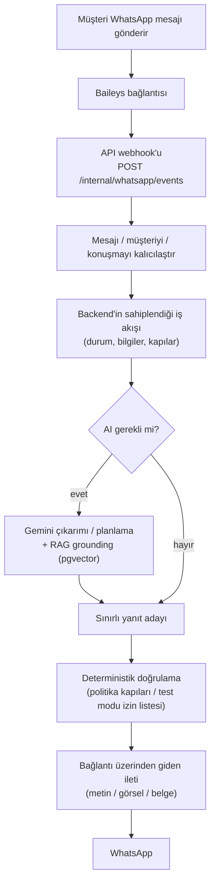
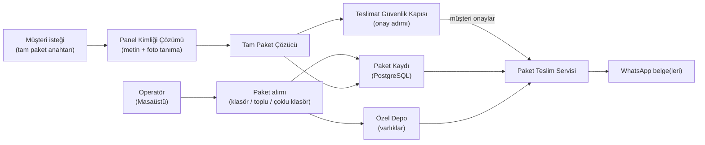
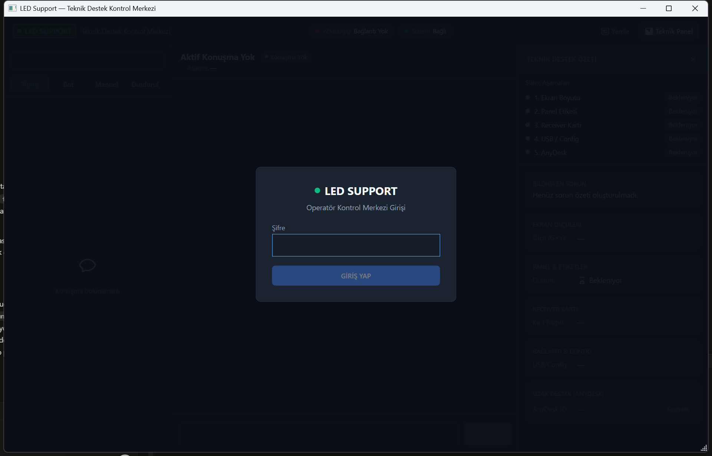
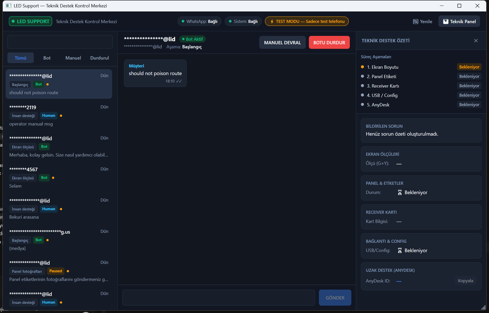
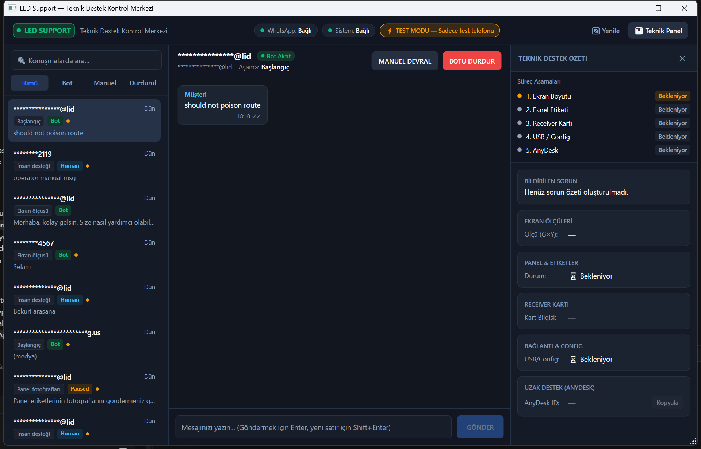
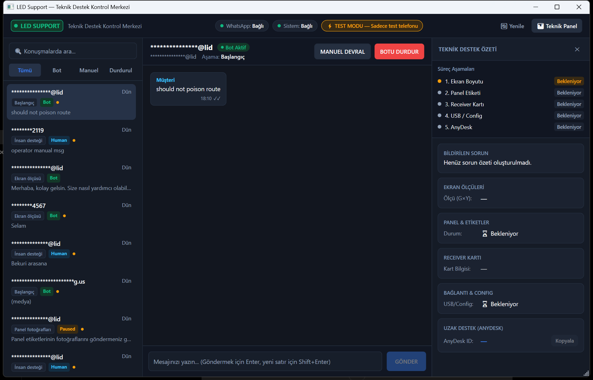

# LedSupBot

<p align="center">
  🌐 <a href="README.md">🇬🇧 English</a> &nbsp;|&nbsp; <strong>Türkçe</strong>
</p>

> WhatsApp tabanlı LED teknik destek platformu &nbsp;→&nbsp; [🇬🇧 İngilizce README](README.md)

LedSupBot; **WhatsApp tabanlı bir LED teknik destek platformudur** ve şunları bir araya getirir:

- bir **Baileys bağlı cihaz bağlantısı** (resmî olmayan, Node.js yan servisi),
- temiz mimari sınırları olan bir **ASP.NET Core backend**,
- **PostgreSQL kalıcılığı** (EF Core + pgvector vektör araması),
- **RAG tabanlı teknik bilgi erişimi**,
- deterministik sınırlara sahip **Gemini destekli metin çıkarımı ve yanıt planlama**,
- bir **WPF operatör masaüstü uygulaması** (`LedSupport`) ve
- WhatsApp üzerinden **deterministik panel paket teslimi**.

> ⚠️ **WhatsApp entegrasyonu uyarısı** — WhatsApp entegrasyonu kişisel bağlı bir cihazda
> [Baileys](https://github.com/WhiskeySockets/Baileys) kullanır. Bu, resmî bir Meta API **değildir**
> ve **Hizmet Şartları / hesap kapatılma** riski taşır. WhatsApp oturum durumu yalnızca yerel kalır ve
> Git'e asla gönderilmez.

---

## Genel Bakış

LedSupBot, teknik destek ekibinin LED panel teşhisi ve dosya teslimatını WhatsApp konuşmalarından yürütmesini sağlar:

1. **Müşteri**, destek WhatsApp numarasına mesaj yazar.
2. **Baileys bağlantısı** (operatörün makinesinde çalışır) olayı yakalar ve iç API'ye iletir.
3. **API**; mesajı, müşteriyi ve konuşmayı kalıcılaştırır ve **backend'in sahiplendiği bir iş akışı** çalıştırır.
4. İş akışı; teknik belgeler üzerinden **RAG erişimi** (pgvector) ile bütünleyerek **Gemini**'yi sınırlı çıkarım ve ifadeleme için kullanabilir.
5. Panel kimliği bilindiğinde **panel paket sistemi** **tam (exact) paketi** çözer ve bir **müşteri onay kapısı** sonrası paket varlıklarını **WhatsApp belgeleri** olarak teslim eder.
6. Operatör her şeyi **LedSupport masaüstü uygulamasından** izler; uygulama **SignalR** ve admin API ile senkronize kalır.

İş akışı durumu, bilgiler, paket teslimatı ve güvenlik kararlarında **AI değil backend** yetkilidir.

---

## Ana Özellikler

| Alan | Özellik | Durum |
|---|---|---|
| WhatsApp bağlı cihaz entegrasyonu | Baileys yan servisi (`connector/`): QR eşleme, oturum kalıcılığı, webhook iletimi | ✅ Uygulandı — *resmî değil, manuel eşleme gerekli* |
| Backend API | ASP.NET Core 8 minimal API'ler, Swagger (`/swagger`), health check (`/health`) | ✅ Uygulandı |
| Kalıcılık | PostgreSQL 16 + EF Core 8 code-first, Npgsql, sürüm takip eden migration'lar, başlangıçta otomatik migration | ✅ Uygulandı |
| Teknik bilgi / RAG | PDF alımı → parçalama → Gemini embedding → pgvector kosinüs erişimi | ✅ Uygulandı |
| AI yanıt hattı | Gemini çıkarımı, konuşma planlama, web grounding, görüntü analizi — deterministik kapılarla sınırlı | ✅ Uygulandı |
| Gerçek zamanlı operatör senkronu | SignalR hub (`/hubs/admin`) mesaj / operatör durumu / WhatsApp durumu olayları gönderir | ✅ Uygulandı |
| Operatör masaüstü uygulaması | WPF `LedSupport` — konuşma listesi, yazıcı, panel dosyaları, eğitim verileri, eşleme | ✅ Uygulandı |
| Panel paketi alımı | Tek klasör, toplu klasör ve çoklu klasör seçimli alım | ✅ Uygulandı |
| Panel paket teslimatı | Tam paket çözümleme → güvenlik kapısı → onay → WhatsApp belge teslimatı | ✅ Otomatik test kapsamı — *gerçek WhatsApp E2E manuel* |
| Teacher Mode | AI eğitim verisi toplama + operatör geri bildirimi (onayla / reddet / düzenle) | ✅ Uygulandı |
| Doğrulanmış vaka belleği | Operatörler yeniden kullanılabilir vaka belleği oluşturur / doğrular / reddeder | ✅ Uygulandı |
| Admin web paneli | React + TypeScript (Vite) iskelesi | ⚠️ Yalnızca iskelet |
---

## Mimari

```mermaid
flowchart LR
    C(["Müşteri<br/>WhatsApp"])
    B["Baileys Bağlantısı<br/>(Node.js yan servisi)"]
    API["ASP.NET Core API"]
    DB[("PostgreSQL<br/>+ pgvector")]
    AI["Gemini"]
    SIG["SignalR<br/>(/hubs/admin)"]
    DESK["LedSupport Masaüstü<br/>(WPF operatör uygulaması)"]
    PKG["Özel Medya Deposu<br/>(panel paket varlıkları)"]

    C <-->|"WhatsApp mesajları / belgeleri"| B
    B <-->|"webhook olayları / gönderim"| API
    API <--> DB
    API <-->|"embedding + erişim"| DB
    API <-->|"çıkarım / planlama / grounding"| AI
    API --|"gerçek zamanlı olaylar"| SIG
    SIG -.->|"güncellemeler"| DESK
    DESK <-->|"admin REST + SignalR"| API
    API <--> PKG
```

- **Baileys bağlantısı** yalnızca ince bir loopback yan servisidir: ne yanıtlanacağına, ne teslim edileceğine ne de ne saklanacağına karar vermez.
- **Backend iş akışı** servisleri durumu kalıcılaştırır ve doğrular; AI yalnızca sınırlı çıkarım, grounding ve ifadelemeye katkı verir.
- **Masaüstü** ve **admin web** aynı admin API'sini kullanır; gerçek zamanlı güncellemeler SignalR üzerinden gelir.

---

## Nasıl Çalışır

### WhatsApp Mesaj Akışı



Temel ilkeler:

- **Backend iş akışının sahibidir.** AI, iş akışı durumunu, müşteri bilgilerini, paket gerçeğini veya teslim hedeflerini doğrudan değiştiremez.
- **AI sınırlıdır.** Çıkarım sonuçları doğrulama kapılarından geçer; deterministik kurallar önce çalışır (`PreferDeterministicFirst=true`).
- **Otomatik yanıt seçimlidir.** `Workflow:AutoReplyEnabled` botun herhangi bir şey gönderip gönderemeyeceğini denetler. Gelen koalescing ve doğal zamanlama gecikmeleri yapılandırılabilir.
- **Kendi kendine mesaj gönderme korunur.** Grup sohbetleri ve kendi kendine döngüler yok sayılır; bağlantı self-JID'leri bildirir, böylece bot kendisine asla yanıt vermez.

### Teknik Bilgi / RAG

Teknik belgeler (PDF) `LedSupBot.KnowledgeCli` ile alınır:

1. **PdfPig** ile yerel metin çıkarımı; kalite düşükse **Gemini vision / OCR yedeği** sayfa çıkarımını yeniden çalıştırır.
2. Belgeler meta veri ile etiketlenir (üretici, ürün tipi, ürün ailesi, model) ve parçalara bölünür.
3. Parçalar **Gemini embedding** (768 boyut) ile vektörleştirilir ve **pgvector** içinde saklanır.
4. Erişim, isteğe bağlı meta veri filtreleri ile **kosinüs benzerliği** kullanır ve sayfa/bölüm referanslarıyla grounded parçalar döndürür.

Bilgi külliyatı (PDF dosyaları) yerel kalır — `knowledge/raw/` gitignore'ludur ve deponun parçası değildir.

---

## Panel Paket Sistemi

Panel paketleri LED panel desteğini deterministik hâle getirir: müşteri panelini söyler, bot *tam* paketi çözer ve operatör varlıklarını WhatsApp üzerinden gönderir.

### Paket Kimliği ve Adlandırma Kuralı

**Klasör / paket adı, paket kimliğidir.** İç dosya adları sıradan varlıklardır ve asla kimlik olarak kullanılmaz.

Biçim: `P{Pitch}+{Chipset}+{Decoder}`

| Örnek paket klasörü | Aile |
|---|---|
| `P2.5+1065S+2012` | P2.5 / 1065S / 2012 |
| `P1.86+1065+2018` | P1.86 / 1065 / 2018 |
| `P3.076+1065AP+1012` | P3.076 / 1065AP / 1012 |
| `P1.53+FM6126A+138` | P1.53 / FM6126A / 138 |

Her paket dahili olarak `P2.5-1065S-2012` gibi kurallı (canonical) bir anahtarla saklanır (normalize edilmiş, büyük harf).

Bir paket **birden çok dosya** içerebilir. Tanınan varlık türleri:

- **Firmware** — `.hex`
- **Alıcı (receiver) konfigürasyonu** — `.rcvbp`

Varlıklar mevcut özel medya-deposu mimarisiyle saklanır (SHA-256, sürümlü, boyut sınırları uygulanır) ve asla genel yollar üzerinden ifşa edilmez.

### Panel Paket Teslim Akışı



Kod ile zorunlu tutulan teslim kuralları:

- Müşterinin paket anahtarı **tam olarak tek bir pakete** çözülmelidir (`ExactMatch`). Belirsizlik, eksik bilgi, pasif veya tamamlanmamış paketler **teslim edilmez**.
- Onay sonrası içeriği değişen paket, kapatılmış dava veya çakışan kimlik hâlinde teslim engellenir.
- Herhangi bir dosya gönderiminden önce bir **onay durumu** (istek → onayla / reddet → geçersiz kıl) bulunur.
- Teslim **dava başına** serileştirilir ve `AutoReplyEnabled` gerektirir; müşteriler asla rastgele bir depo anahtarı, yol veya varlık kimliği seçemez.
- Her teslim girişimi, doğrulanmış varlıklar (SHA-256) ve mesaj kimlikleriyle kalıcılaştırılır.
---

## Operatör Masaüstü Uygulaması

**LedSupport Desktop** (`src/LedSupBot.Desktop`, WPF / .NET 8) ana operatör konsoludur:

- **Konuşma listesi** — BOT / HUMAN / PAUSED rozetleri ve arama/filtre
- **Gerçek zamanlı sohbet görünümü** — gelen ve giden mesajlar SignalR ile güncellenir
- **Yazıcı (composer)** — teknisyen yanıtları için
- **İş akışı göstergeleri** — destek adımları, panel kimliği durumu, AnyDesk uyarıları
- **Panel dosya yönetimi** — paket oluştur/düzenle, firmware (`.hex`) ve alıcı konfigürasyonu (`.rcvbp`) yükle, etkinleştir / arşivle / geri al
- **Klasör alımı** — tek klasör, toplu alım (alt klasörleri otomatik keşif) ve çoklu klasör seçimi
- **Teacher Mode** — AI taslaklarını incele ve eğitim geri bildirimi ver
- **Eğitim verisi görünümü** — filtrelerle AI eğitim örneklerine göz at
- **Vaka belleği incelemesi** — yeniden kullanılabilir vaka belleği taslağı / doğrulama / red
- **WhatsApp eşleme** — uygulama içi QR eşleme ve oturum sıfırlama
- **Yerel servis yöneticisi** — PostgreSQL, API ve bağlantıyı isteğe bağlı otomatik başlatır

## Ekran Görüntüleri

> Aşağıdaki ekran görüntüleri mevcut geliştirme döngüsünden gerçek çekimlerdir. Yönelim için olduğu gibi korunmuştur; son manuel sürüm doğrulaması sonrası yenilenecektir.

| Ekran | Görsel |
|---|---|
| Giriş |  |
| Ana pencere |  |
| Aktif konuşma |  |
| Teknik panel |  |

## Proje Yapısı

```text
led-sup-bot/
├─ src/
│  ├─ LedSupBot.Api/             # ASP.NET Core 8 API — REST, SignalR, Swagger, health check
│  ├─ LedSupBot.Application/     # Kullanım senaryoları, iş akışları, panel dosyaları, admin, AI sınırları
│  ├─ LedSupBot.Domain/          # Varlıklar, value object'ler, enum'lar, port arayüzleri
│  ├─ LedSupBot.Infrastructure/  # EF Core / Npgsql / pgvector, Gemini, depolama, bilgi
│  ├─ LedSupBot.Desktop/         # WPF operatör uygulaması (LedSupport)
│  ├─ LedSupBot.Workers/         # Arka plan işçi servisleri
│  └─ LedSupBot.KnowledgeCli/    # Teknik bilgi alım / arama CLI'ı
├─ connector/                    # Resmî olmayan Baileys WhatsApp yan servisi (Node.js)
├─ admin/                        # React + TypeScript (Vite) admin web iskelesi
├─ tests/
│  ├─ LedSupBot.UnitTests/       # .NET birim testleri (xUnit)
│  └─ LedSupBot.IntegrationTests/# .NET entegrasyon testleri (Testcontainers PostgreSQL)
├─ scripts/                      # QA / E2E yardımcı betikleri (SQL + PowerShell)
├─ docs/                         # Karar kayıtları, faz dokümanları, görseller, iş akışı politikası
├─ knowledge/                    # Yerel bilgi külliyatı (gitignore) + önbellek
├─ screenshots/                  # Özgün UI çekimleri
├─ docker-compose.yml            # PostgreSQL 16 + pgvector (pgvector/pgvector:pg16)
├─ .env.example                  # Ortam değişkeni kontrol listesi
├─ appsettings.Local.example.json# İsteğe bağlı yerel yapılandırma şablonu
└─ LedSupBot.sln                 # Çözüm dosyası
```

## Teknoloji Yığını

| Alan | Teknoloji |
|---|---|
| Backend | ASP.NET Core / C# / .NET 8 (SDK `global.json` ile sabitlenmiştir) |
| Masaüstü | WPF / .NET 8 (`net8.0-windows`) |
| Veritabanı | PostgreSQL 16 (Docker imajı `pgvector/pgvector:pg16`) |
| ORM / Migration | EF Core 8 + Npgsql, sürüm takip eden migration'lar |
| Vektör arama | pgvector (kosinüs mesafesi) |
| WhatsApp | Baileys 6.7.x Node yan servisi — *resmî değil* |
| Gerçek zamanlı | SignalR (`/hubs/admin`) |
| AI | Google Gemini (çıkarım, embedding, planlama, web grounding, görüntü analizi) |
| Bilgi çıkarımı | PdfPig + Gemini vision/OCR yedeği |
| Admin web | React 19 + TypeScript + Vite |
| Testler (.NET) | xUnit, Microsoft.NET.Test.Sdk, Testcontainers PostgreSQL |
| Testler (bağlantı) | Node yerleşik test çalıştırıcısı (`node --test`) |
| Testler (admin) | Vitest + Oxlint |
| CI | GitHub Actions (`.github/workflows/ci.yml`) — .NET çözümü ve admin uygulamasını derler |
---

## Başlangıç

### Ön Koşullar

| Araç | Notlar |
|---|---|
| Git | Herhangi bir güncel sürüm |
| .NET SDK | 8.0.x (depo `global.json` içinde `8.0.424` sabitler) |
| Node.js | 20+ (bağlantı); admin CI Node 22 kullanır |
| npm | Node.js ile birlikte gelir |
| Docker Desktop | PostgreSQL (`docker-compose.yml`) ve entegrasyon testleri (Testcontainers) için |
| WhatsApp hesabı | Bağlı cihaz + QR eşleme için |
| Google Gemini API anahtarı | AI özellikleri ve bilgi embedding'leri için |

### 1. Klonlama

```powershell
git clone https://github.com/HalilMertDeveli/led-sup-bot.git
cd led-sup-bot
```

### 2. PostgreSQL'i başlatma

```powershell
docker compose up -d
```

Veritabanı: `led_sup_bot`, kullanıcı/şifre `postgres`/`postgres`, adres `localhost:5432`. Veriler `led_sup_bot_pgdata` isimli Docker volume'unda saklanır.

### 3. API'yi yapılandırma

`.env.example` dosyasını kontrol listesi olarak kopyalayın ve API'yi çalıştıracak kabukta gerekli değişkenleri tanımlayın:

```powershell
$env:DATABASE_CONNECTION_STRING = "Host=localhost;Port=5432;Database=led_sup_bot;Username=postgres;Password=postgres"
$env:GEMINI_API_KEY = "<anahtarınız>"
$env:ASPNETCORE_ENVIRONMENT = "Development"
```

> API **süreç ortam değişkenlerini** okur (kendisi bir `.env` dosyası yüklemez; masaüstü uygulaması başlattığı servisler için `.env` yükleyebilir). Veritabanı yapılandırıldıysa bekleyen EF Core migration'ları **başlangıçta otomatik uygulanır**.

İsteğe bağlı API değişkenleri `.env.example`'dan kopyalanabilir (bağlantı sırrı, admin paneli, medya deposu, iş akışı bayrakları…).

### 4. Bağlantıyı yapılandırma

```powershell
cd connector
Copy-Item .env.example .env
```

`CONNECTOR_SHARED_SECRET` değerini API'nin `WHATSAPP_CONNECTOR_SHARED_SECRET` değeriyle **birebir aynı** yapın. Bağlantı `3100` portunu dinler ve gelen olayları `ASPNET_WEBHOOK_URL` adresine gönderir (varsayılan `http://127.0.0.1:5080/internal/whatsapp/events`).

---

## Projeyi Çalıştırma

### API

```powershell
# depo kökünden
dotnet run --project src/LedSupBot.Api --launch-profile http
```

- API: <http://localhost:5080>
- Swagger: <http://localhost:5080/swagger>
- Health: <http://localhost:5080/health>

### Bağlantı (Connector)

```powershell
cd connector
npm install
npm start
```

İlk çalıştırmada terminaldeki QR kodunu taratın: **WhatsApp → Bağlı cihazlar → Cihaz bağla**. WhatsApp oturumu `connector/.sessions/` altında yerel saklanır (gitignored, asla gönderilmez).

> Manuel doğrulama yapmadan otomatik yanıtları çalıştırmayın. Kontrollü bir test davranışı doğrulana kadar `Workflow:AutoReplyEnabled=false` tutun.

### Operatör masaüstü uygulaması

```powershell
# depo kökünden
dotnet run --project src/LedSupBot.Desktop
```

Masaüstü uygulaması PostgreSQL, API ve bağlantıyı otomatik başlatabilir (`src/LedSupBot.Desktop/appsettings.json`: `AutoStartPostgreSql`, `AutoStartApi`, `AutoStartConnector`) ve ardından `5080` portundaki admin API'sine giriş yapar.

### Bilgi CLI'ı

Depo kökünden çalıştırın (API bağlantı yapılandırmasını okur):

```powershell
# bilgi tabanı durumu
dotnet run --project src/LedSupBot.KnowledgeCli -- status

# knowledge/raw içindeki PDF'leri al (önce dry-run)
dotnet run --project src/LedSupBot.KnowledgeCli -- import --dry-run
dotnet run --project src/LedSupBot.KnowledgeCli -- import

# bilgi tabanında arama
dotnet run --project src/LedSupBot.KnowledgeCli -- search --query "P2.5 1065S 2012"
```

### Admin web (isteğe bağlı, iskelet)

```powershell
cd admin
Copy-Item .env.example .env
npm install
npm run dev
```

Dev sunucu: <http://localhost:5173> (`VITE_API_BASE_URL` varsayılanı `http://localhost:5080`).
---

## Yapılandırma

### API ortam değişkenleri

| Değişken | Amaç |
|---|---|
| `DATABASE_CONNECTION_STRING` | PostgreSQL bağlantı dizesi |
| `ASPNETCORE_ENVIRONMENT` | Ortam (`Development`, …) |
| `GEMINI_API_KEY` / `GEMINI_MODEL` | Gemini sağlayıcı anahtarı/modeli (varsayılan `gemini-3.6-flash`) |
| `EMBEDDING_PROVIDER` / `EMBEDDING_MODEL` / `EMBEDDING_DIMENSIONS` | Embedding sağlayıcısı (varsayılan Gemini, 768 boyut) |
| `WHATSAPP_CONNECTOR_ENABLED` | Baileys bağlantı istemcisini aç/kapat |
| `WHATSAPP_CONNECTOR_BASE_URL` | Bağlantı taban adresi (varsayılan `http://127.0.0.1:3100`) |
| `WHATSAPP_CONNECTOR_SHARED_SECRET` | Paylaşılan sır — `connector/.env` ile eşleşmeli |
| `ADMIN_DASHBOARD_PASSWORD` | Admin paneli giriş şifresi (yalnızca sunucu tarafı) |
| `ADMIN_SESSION_SECRET` | Admin oturum çerezini imzalama sırrı (>= 32 karakter) |
| `MEDIA_STORAGE_ROOT` | Yerel özel medya kökü (varsayılan `./data/media`) |
| `STORAGE_CONNECTION_STRING` / `STORAGE_CONTAINER_NAME` | İsteğe bağlı harici depolama |
| `WORKFLOW_AUTO_REPLY_ENABLED` | Bot giden yanıtları için ana anahtar |
| `WORKFLOW_NATURAL_TIMING_ENABLED` | Doğal yazma gecikmeleri |
| `WORKFLOW_INBOUND_COALESCE_ENABLED` | Belirli bir penceredeki mesaj patlamalarını birleştir |

Tüm değerler yer tutucu veya gerçek yerel sır olmalıdır — gerçek sırlar asla gönderilmemeli.

### Bağlantı değişkenleri

| Değişken | Amaç |
|---|---|
| `PORT` | Bağlantı portu (varsayılan `3100`) |
| `CONNECTOR_SHARED_SECRET` | Paylaşılan HMAC sırrı — API ile eşleşmeli |
| `WHATSAPP_CONNECTOR_SHARED_SECRET` | Bağlantının kabul ettiği takma ad |
| `ASPNET_WEBHOOK_URL` | İç API webhook adresi |
| `SESSION_DIR` | Oturum dizini (varsayılan `.sessions`) |
| `LOG_LEVEL` | pino log seviyesi |

### Asla göndermeyin

- `.env`, `connector/.env`, tüm `appsettings.Local.*.json` dosyaları
- `connector/.sessions/` (WhatsApp bağlı cihaz kimlik bilgileri)
- `knowledge/raw/`, `knowledge/cache/`, `data/media/`
- `node_modules/`, `bin/`, `obj/`

Bu yollar `.gitignore` kapsamındadır.

---

## Test Etme

```powershell
# .NET: derleme + tüm testler (birim + entegrasyon). Entegrasyon testleri
# Testcontainers ile postgres:16-alpine kullanır; Docker çalışıyor olmalı.
dotnet build LedSupBot.sln --configuration Release
dotnet test LedSupBot.sln --configuration Release --verbosity normal

# Bağlantı birim testleri (Node yerleşik test çalıştırıcısı)
cd connector
npm test

# Admin web testleri + üretim derlemesi
cd ..\admin
npm run test
npm run build
```

Test kapsamı şunları içerir: panel kimliği ayrıştırma ve foto tanıma, tam paket çözümleme, teslim güvenlik kapısı, toplu alım, WhatsApp olay eşleme, devralma/duraklat/devam, iş akışı çıkarımı, Gemini orkestrasyonu ve gizliliği, RAG erişim politikası, medya deposu ve SignalR senkronizasyonu.

> **Gerçek WhatsApp E2E manueldir.** GitHub Actions CI, `ubuntu-latest` üzerinde .NET ve admin test paketlerini derler ve çalıştırır; **hiçbir gerçek WhatsApp etkinliği** yapmaz. Gerçek bir WhatsApp hesabına mesaj göndermek manuel QR eşleme ve kontrollü testler gerektirir (örneğin bağlantı etkinken ve `Workflow:AutoReplyEnabled` açıkken `/internal/whatsapp/send-text` uç noktası).
---

## Geliştirme İş Akışı

Her görev **tek görev → tek dal → tek PR** ilkesini izler:

1. Doğru tabandan dal oluşturun: `feature/<görev>`, `fix/<hata>`, `docs/<dokümantasyon>`, `refactor/<görev>`, `test/<görev>`.
2. Uygulayın, test ekleyin, derleyin ve doğrulayın.
3. Net bir mesajla commit atın; ilgisiz değişiklikleri karıştırmayın.
4. Push edin ve uygun taban dala karşı PR açın.
5. İnceleme + CI sonucunu bekleyin; yalnızca onay sonrası birleştirin.

Tam politika ve örnekler: [docs/development-workflow.md](docs/development-workflow.md).

---

## Güvenlik Notları

- **Paylaşılan sır** — API ve bağlantı, sabit süreli karşılaştırma ile paylaşılan bir sır (`X-Connector-Secret`) kullanarak doğrulanır. API, o sır olmadan bağlantı olaylarını kabul etmez.
- **Gönderilmiş sır yok** — `.env.example` dosyaları yalnızca yer tutucu içerir; gerçek API anahtarları ve şifreler Git dışında kalır.
- **WhatsApp gizliliği** — bağlı cihaz oturum materyali (`connector/.sessions/`, `creds.json`, pre-key'ler…) gitignore'ludur ve asla gönderilmez.
- **Operatör kimlik doğrulaması** — admin yüzeyi sunucu tarafı şifre ve HttpOnly imzalı oturum çerezi kullanır. Tarayıcı/masaüstü bağlantı sırrını veya Gemini API anahtarını asla almaz.
- **Deterministik teslim** — müşteriler rastgele depolama anahtarı, yol veya varlık kimliği seçemez; tam paket çözücü ve onay kapısı her dosya gönderimini yönetir.
- **Kontrollü otomasyon** — `Workflow:AutoReplyEnabled` tüm bot giden trafiğini kapılar; test modu izin listesi doğrulama sırasında riski sınırlar.
- **Medya gizliliği** — gelen müşteri medyası özel yerel depoda saklanır, doğrulanır ve yalnızca depolama anahtarıyla referanslanır (genel URL yok).

---

## Güncel Durum

| Bileşen | Durum |
|---|---|
| ASP.NET Core API | ✅ Uygulandı |
| PostgreSQL + EF Core kalıcılığı | ✅ Uygulandı |
| pgvector RAG erişimi | ✅ Uygulandı |
| Gemini entegrasyonu | ✅ Uygulandı |
| SignalR gerçek zamanlı senkron | ✅ Uygulandı |
| WPF Masaüstü (`LedSupport`) | ✅ Uygulandı |
| WhatsApp bağlantısı (Baileys) | ✅ Uygulandı — *resmî değil; manuel QR eşleme; gerçek E2E manuel* |
| Panel paket alımı | ✅ Uygulandı |
| Panel paket teslimatı | ✅ Otomatik kapsam — *gerçek WhatsApp E2E manuel doğrulama gerektirir* |
| Teacher Mode / eğitim verisi | ✅ Uygulandı |
| Doğrulanmış vaka belleği | ✅ Uygulandı |
| Admin web paneli | ⚠️ Yalnızca iskelet |
| Sesli metin / metinden ses | ⚠️ Arayüzler mevcut; sağlayıcılar varsayılan olarak yapılandırılmadı |

> Durum, mevcut depo durumuna ve test geçmişine dayanır. "Gerçek WhatsApp E2E geçti" iddiasını bilinçli olarak içermez — bunun için hâlâ manuel kontrollü bir çalıştırma gerekir.

---

## Dokümantasyon

- [🇬🇧 English README](README.md)
- [docs/development-workflow.md](docs/development-workflow.md)
- [docs/DECISIONS.md](docs/DECISIONS.md) — mimari karar kayıtları
- [docs/FAZ1-ARCHITECTURE-AUDIT.md](docs/FAZ1-ARCHITECTURE-AUDIT.md)
- [docs/FAZ2-PROJECT-FOUNDATION.md](docs/FAZ2-PROJECT-FOUNDATION.md)
- [docs/FAZ3-DATABASE.md](docs/FAZ3-DATABASE.md)
- [docs/FAZ4-PERSONAL-WHATSAPP-AUDIT.md](docs/FAZ4-PERSONAL-WHATSAPP-AUDIT.md)
- [docs/FAZ4.5-WHATSAPP-CONNECTOR.md](docs/FAZ4.5-WHATSAPP-CONNECTOR.md)
- [docs/MEDIA-STORAGE.md](docs/MEDIA-STORAGE.md)

---

## Katkı / Dal Politikası

- Tek görev → tek dal → tek PR (dallar: `feature/*`, `fix/*`, `docs/*`, `refactor/*`, `test/*`).
- İncelemeden önce kendi dokümantasyonunuzu birleştirmeyin.
- Birden çok görev paralel koşarken **ayrı Git worktree'leri** kullanın; böylece commit'lenmemiş yerel çalışma asla bozulmaz.
- Kod tabanında var olmayan özellikleri ilan etmeyin ve sır ya da WhatsApp oturum verisi göndermeyin.
- Bu depo şu anda bir lisans dosyası ile dağıtılmamaktadır; harici yeniden kullanım öncesi lisans durumunu doğrulayın.
| Konuşma servisleri | STT / TTS arayüzleri mevcut; bağlantı giden ses destekler | ⚠️ Varsayılan olarak sağlayıcı konfigüre edilmedi |